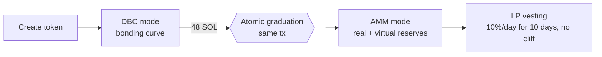

# YeetLaunch — powered by YeetAMM

**A Solana DEX with its own token launch program and a fully self-contained liquidity stack.**

Native dynamic bonding curve · native AMM · native aggregator & indexer · fixed-fee execution · vesting-backed post-graduation liquidity

---

## What it is

YeetLaunch lets anyone launch a token on a bonding curve in minutes, at **[yeetlaunch.io/token-creator](https://yeetlaunch.io/token-creator)** or **[from another site](docs/LAUNCH_FROM_YOUR_SITE.md)**. When the curve fills, the token **graduates atomically** into a YeetAMM pool — no waiting, no separate migration, no external DEX. The whole lifecycle — price discovery, graduation, market-making, LP vesting — runs on one on-chain program, internally security-reviewed and tested (independent external audit pending), plus a native aggregator and indexer. Nothing routes through third-party venues.

The design goal is **legibility**: fees you can reason about, liquidity you can trust after graduation, and anti-dump mechanics that are documented in the open rather than hidden.

## How it works

A token lives in one program, in two phases on the same pool account:

1. **DBC mode (launch curve).** Price discovery via virtual reserves. Flat 1.00% fee.
2. **Graduation.** When the pool's quote reserve reaches its graduation threshold (**48 SOL** for tokens launched since 14 October 2026, 32 SOL before), the *same transaction that crosses the threshold* flips the pool from DBC → AMM in place. Real reserves carry over intact; virtual reserves are **preserved as an immutable anchor** so the first AMM spot price exactly equals the final curve price, and no later slot is priced differently.
3. **AMM mode.** Constant-product execution over real + fixed virtual reserves, with LP retained in-pool to grow the invariant.

## Fees

Flat **1.00% per swap**, from the first trade, enforced on-chain. Only the split changes at graduation — the creator's cut never does.

| Mode | Total | YeetLaunch | Creator | LP (stays in pool) |
|------|:-----:|:----------:|:-------:|:------------------:|
| **DBC** (pre-grad) | 1.00% | 0.70% | 0.30% | 0.00% |
| **AMM** (post-grad) | 1.00% | 0.50% | 0.30% | 0.20% |

Creators earn **0.30% of every swap for the life of the token**, in both modes, plus daily LP-value payouts after graduation.

## Anti-dump, in the open

Sell restrictions are the single most honeypot-associated mechanic in the space, so YeetLaunch documents them loudly instead of hiding them. Post-graduation, these layers work together — and **buys are never restricted**:

- **Per-slot hard cap** — at most **5% of reserves** can be sold per slot (aggregate across all wallets); cumulative per-slot accounting closes the multi-wallet same-slot bypass.
- **Adaptive per-transaction allowance** — a per-transaction cap that draws down on sells and recovers over time, with a 0.5% floor always available.
- **Fixed virtual anchor** — virtual reserves never change after graduation, which removes graduation-crossing round-trip arbitrage without a time-varying price.
- **LP lock & vesting** — **30% of LP is permanently locked**; the remaining 70% vests to the creator at **10% per day for 10 days** from graduation, with no cliff (pools that graduated before 17 October 2026 keep a 48-hour cliff, then 14 days).

These limits do not create a SOL floor or stop a market dump: the cap is per slot, not per seller, and automated sellers can exit within seconds. See §1 and §7.6 of the whitepaper for what the design does and does not protect against.

## Documentation

| Document | Description |
|----------|-------------|
| **[Launch from your site](docs/LAUNCH_FROM_YOUR_SITE.md)** | Signing links: let people launch a token on YeetLaunch from your site, approving in their own wallet. |
| **[Whitepaper (PDF, v1.7.2)](https://yeetlaunch.io/YeetLaunch_Whitepaper_v1.7.2.pdf)** | The current protocol design: DBC math, graduation, fee model, anti-dump, LP vesting, and assurance results. |
| [Whitepaper v1.4 (PDF)](docs/YeetLaunch_Whitepaper_v1.4.pdf) · [Markdown](docs/YEETLAUNCH_POWERED_BY_YEETAMM_WHITEPAPER.md) | Archived July 2026 edition. Superseded: it describes virtual-reserve decay (removed August 2026), the 32 SOL threshold and the old vesting schedule. |
| [YeetAMM Routing & Integration Guide](docs/YEETAMM_ROUTING_INTEGRATION.md) | For external aggregators/routers: program IDs, pool-state layout, the fee model, how to quote (API / on-chain simulation / executed trades), and how to respect the per-slot sell cap. |
| [YeetAMM TypeScript SDK](https://github.com/YeetLaunch/yeet-amm-sdk) | Thin client for wallets, bots, and trackers: PDA derivation, swap instruction builders, account/error decoding, decimal helpers, and a REST client. Turnkey buy/sell with automatic wSOL wrap/unwrap. |

## At a glance

- **Graduation threshold:** 48 SOL for tokens launched since 14 October 2026 (32 SOL before)
- **Token creation:** 0.03 SOL, at [yeetlaunch.io/token-creator](https://yeetlaunch.io/token-creator)
- **Graduation:** atomic, in-place DBC → AMM
- **Post-grad liquidity:** 30% permanently locked, 70% creator-vesting (10%/day for 10 days, no cliff)
- **Stack:** 100% Yeet-native — DBC, AMM, aggregator, and indexer are all first-party

---

**[yeetlaunch.io](https://yeetlaunch.io)**

*The source code for the protocol and platform is proprietary. This repository contains public documentation only.*

