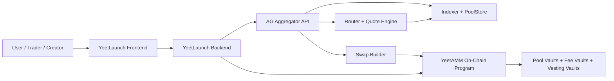
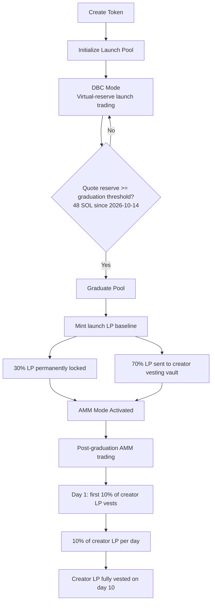
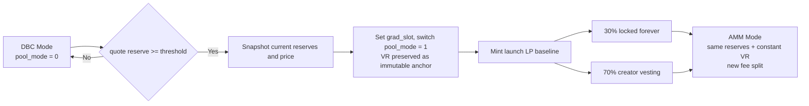
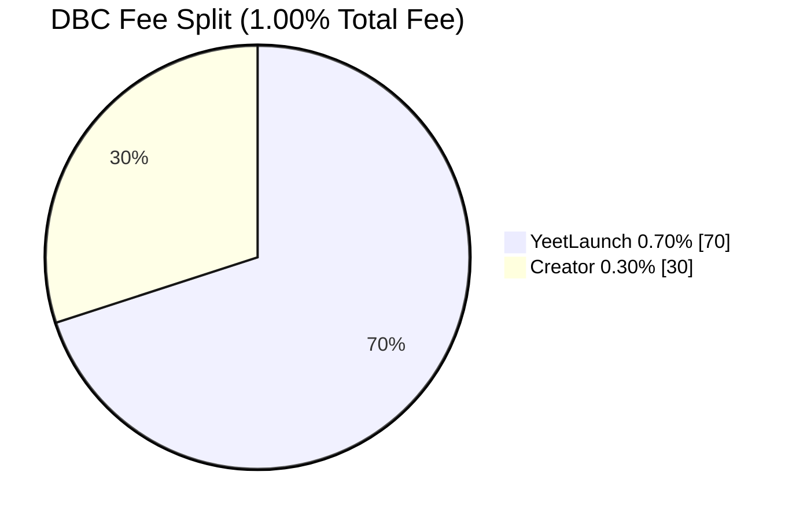
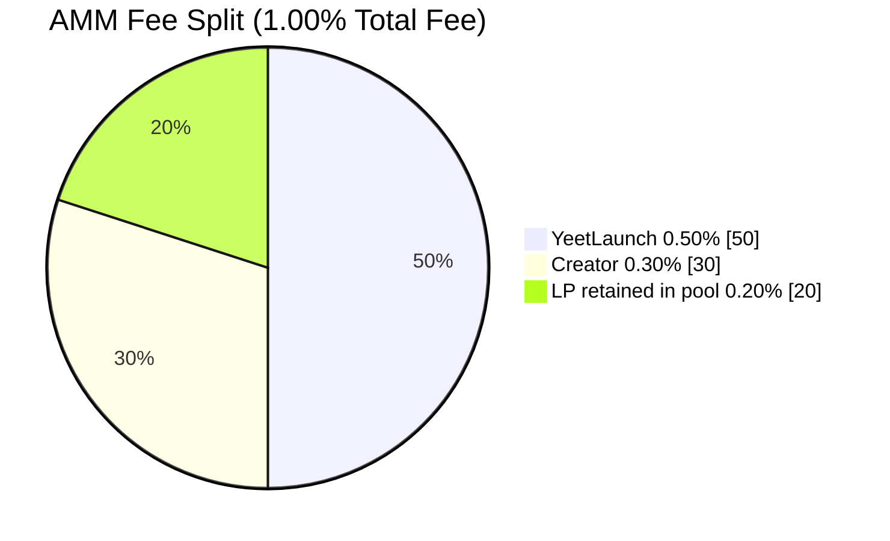
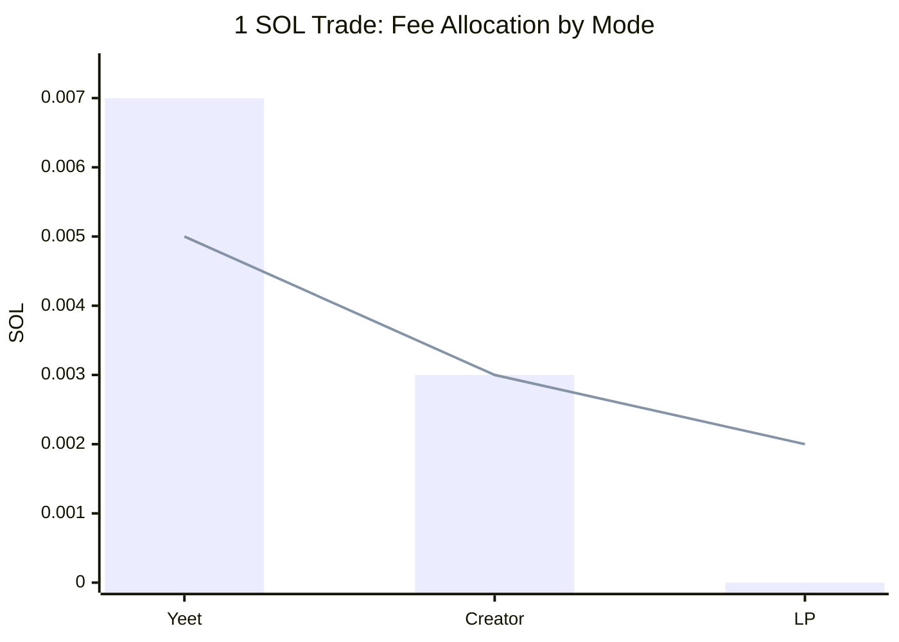
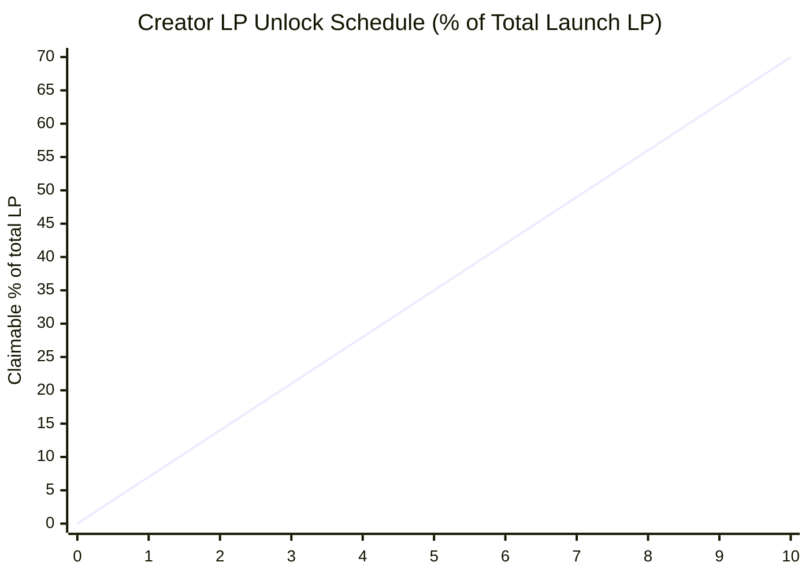

# YeetLaunch powered by YeetAMM
## Production Whitepaper

**Version:** 1.7.2 (rev. 2026-10-25)  
**Date:** 2026-10-25  
**Program release described:** YeetAMM `v1.4.0` (permanent-lock sink and 10-day creator vesting)  

> **Security status:** internally security-reviewed and tested; independent external audit pending (§15.4).
>
> **Release status:** v1.4.0 is live on mainnet. It was upgraded through the 2-of-3 multisig on 17 October 2026 (execute transaction `54jopZakxzXzCpzg3vZLBRrpEosHXJ7tTd6ht88iE72QbDAtuG53vCdP5nf8yPrCNjwNiEPC84xoFCoPvBGXY9Ww`, slot 458,203,129), and the on-chain program hash equals the release build. Pools that graduated earlier keep the schedule they graduated under, and pools created earlier keep their program-controlled lock vault.
**System:** Solana DEX — bonding curve and AMM in one on-chain program  
**Evidence Base:** April 2026 internal code review and adversarial QA, June 2026 adversarial QA review, on-chain math review, deterministic simulations, current native-stack source review, targeted protocol tests, and a July 2026 full-lifecycle execution against the deployed program bytecode (in-SVM through day-16 LP vesting) a live-devnet mint→graduation on the same deployed program, — since the July 2026 mainnet deployment — a live-mainnet launch carried through graduation on the deployed mainnet program, and an October 2026 pre-upgrade adversarial review of the LP lock change, reproduced against the real SPL Token program


> **What changed in v1.7.2** (25 October 2026). Clarifications only; no on-chain protocol behaviour changed. Revised passages are marked *[Revised in v1.7.2]*.
>
> | Section | Change |
> |---|---|
> | §1 | New box: what this design does **not** protect against — a market dump, a SOL floor, bot exits, thin early liquidity. The core-facts table states that a vesting “day” is 216,000 slots. |
> | §3.1, Abstract | AG is a YeetAMM-only router, not a cross-DEX aggregator, and does not compare prices against other Solana venues. |
> | §6.6 | The two threshold cohorts (32 / 48 SOL) and what integrators must do about them; the graduation data available so far. |
> | §9.4, §9.6 | The liquidity protection is scoped: it stops the creator withdrawing launch LP, not holders selling. |
> | §13.1 | Where YeetLaunch is weaker today. |

> **What changed in v1.7.1** (17 October 2026). Substantive revised explanations are marked *[Revised in v1.7.1]*; terminology and table changes are summarized below. These corrections answer an external design review; no on-chain protocol behaviour changed.
>
> | Section | Change |
> |---|---|
> | Header, Abstract, §2.4, §6.5, §10.3, §10.6, §15.4, §16, Appendix B, Appendix C | “Audit” wording replaced: the April 2026 work was an internal review. Standard statement added: internally security-reviewed and tested; independent external audit pending. |
> | §6.2, §6.5, §10.6, §10.9 | Round-trip evidence scoped to tested cases without intervening trades, liquidity events or parameter changes; not a universal no-profit proof. |
> | §20.5 | SDK quotes come from the YeetLaunch API; what does and does not work when the API is down; no native quote helper yet. |
> | §9.2 | A vesting “day” is 216,000 slots; wall-clock unlock times are estimates. |
> | §8.5 | The 1% fee is not the all-in cost: network fee, priority fee, account rent and price impact. |
> | §7.6, §9.6, §12.6 | Permanent LP is not a minimum SOL guarantee; failed transactions can cost fees. Supply presets and authenticated-API exceptions distinguished; “Liquidity” excludes virtual reserves. |
---

## Abstract

YeetLaunch is a Solana-native token launch protocol designed to address a recurring failure pattern in memecoin and community-token markets: launch mechanics are often simple, but incentive alignment is weak, post-graduation liquidity is fragile, fee structures are difficult to reason about, and creators and traders operate under opaque assumptions. YeetLaunch addresses that gap by combining a deterministic launch phase with an AMM execution layer, YeetAMM, that was internally reviewed and tested before release; an independent external audit is still pending (§15.4). *[Revised in v1.7.1]*

The system has two operating phases. In **DBC mode**, a token starts on a launch curve that uses virtual reserves for price discovery and charges a fixed 1.00% total fee. That fee is split exactly **70 bps to YeetLaunch** and **30 bps to the token creator**, with **no LP allocation**. When the pool’s quote reserve reaches its **graduation threshold** (**48 SOL** for tokens launched since 14 October 2026; **32 SOL** for tokens launched earlier), the pool transitions into **AMM mode** without rebuilding the market: all real reserves carry over intact, and virtual reserves are **preserved as an immutable anchor** to ensure exact price continuity at the boundary. Post-graduation those virtual reserves never change, so the virtual pricing anchor is fixed, while real reserves and depth can change through trading and LP redemptions. This eliminates the graduation-crossing round-trip arbitrage that existed when virtual reserves were zeroed, without introducing a time-varying price that could be farmed by waiting (§7.1.1). In AMM mode, the total fee remains **1.00%**, but the split changes to **50 bps to YeetLaunch**, **30 bps to the creator**, and **20 bps retained in pool reserves** to increase liquidity depth and grow the invariant. *[Revised in v1.7.1]*

This lifecycle runs on YeetLaunch’s own stack: its own DBC logic inside YeetAMM, its own AG router and indexer, and its own YeetAMM pools as the canonical launch and post-graduation venue. AG routes only YeetAMM pools, so it is a YeetAMM router rather than a cross-DEX aggregator *[Revised in v1.7.2]*: the third-party venue adapters it once carried have been removed, and a Jupiter quote client that remains in the codebase is switched off. The launch lifecycle does not depend on a third-party DBC, third-party indexer, third-party aggregator, or third-party AMM pool.

An internal code review and adversarial QA session in April 2026 identified and fixed fee-table and off-chain synchronization defects before release. After remediation, the protocol passed targeted on-chain and TypeScript verification, a **1,000-pool / 10,420-swap** readiness simulation with **0 mismatches, 0 invariant violations, and 0 stuck pools**, and adversarial QA re-verification with **87 Rust unit tests**, **308 Vitest checks**, **284 backend Jest tests**, and **16 adversarial QA evidence proofs** (including the regression guards `qa_evidence_12_production_virtuals_are_time_invariant` and `fixb_01`–`fixb_05`) passing against the repository state at that time; current figures for the v1.4.0 release are in §11.8. In July 2026 the complete token lifecycle — mint → DBC → graduation → post-cliff LP vesting — was additionally executed end-to-end against the **deployed program bytecode**, with the day-16 vesting mark reached in an in-process Solana VM (the LP schedule is fixed in the program and cannot be reached in wall-clock time), and a **live-devnet** launch was carried through graduation on that same deployed program. In July 2026 the program was deployed to **mainnet** under a 2-of-3 multisig upgrade authority (§10.8, Appendix D), and a token has since completed the full lifecycle on mainnet — minted through the production launch path, traded on its bonding curve, and graduated atomically to AMM mode in the transaction that crossed its graduation threshold, followed by the LP vesting schedule then in force (a 48-hour cliff and 14 days) running to completion. That validation pool was deliberately configured with a reduced graduation threshold so the lifecycle could be exercised end-to-end on mainnet without requiring a full threshold of real contribution; production pools are created at the standard threshold (32 SOL before 14 October 2026, 48 SOL since), which is stored in, and verifiable on, every live pool account. This whitepaper describes the design, economics, safety model, lifecycle, and operational implications of that verified state.

---

## Table of Contents

1. Executive Summary  
2. The Problem with the Usual Launch Design  
3. System Overview  
4. Token Lifecycle  
5. Bonding Curve Mechanics  
6. Graduation Mechanism  
7. AMM Design  
8. Fee Model Deep Dive  
9. Liquidity and Vesting Model  
10. Security Model  
11. Simulation and Testing Results  
12. Economic Design  
13. Comparison with Pump.fun and Raydium  
14. Risks and Considerations  
15. Future Roadmap  
16. Conclusion  
17. Appendix A: Core Formulas  
18. Appendix B: Internal Review Findings Incorporated into Release  
19. Appendix C: Source Basis and References  
20. Appendix D: On-Chain Addresses, Verification & Developer Resources

---

# 1. Executive Summary

YeetLaunch is a Solana DEX, built on its own on-chain program, for one narrow objective: make token launches easier to reason about after the first day of hype. The system treats launch, graduation, liquidity formation, and post-launch trading as one continuous financial lifecycle rather than a chain of loosely connected products. That design choice matters. In many launch stacks, creators earn something during the curve phase, traders face changing fee surfaces, and liquidity after migration is either too thin, too discretionary, or too easy to abandon. YeetLaunch instead anchors the lifecycle to a single execution philosophy: deterministic pricing rules, mode-specific fee schedules, transparent value flow, and explicit post-graduation lock and vesting constraints.

| Core fact | Verified production value |
|---|---:|
| DBC total fee | 1.00% |
| DBC split | 0.70% Yeet / 0.30% Creator / 0.00% LP |
| AMM total fee | 1.00% |
| AMM split | 0.50% Yeet / 0.30% Creator / 0.20% LP |
| Graduation threshold | 48 SOL (32 SOL for tokens launched before 2026-10-14) |
| Permanent LP lock | 30% |
| Creator LP vesting | 70% |
| Vesting cadence | 10% of the creator’s share per day for 10 days from graduation, no cliff (pools that graduated before v1.4.0: 48h cliff, then 14 days). A “day” is 216,000 slots, about 24 hours; wall-clock unlock times are estimates |
| Post-graduation sell cap | ≤5% of reserves per slot, adaptive down to a 0.5% floor |

> **What this design does not protect against** *[Revised in v1.7.2]*
>
> - **A market dump.** The lock and vesting stop a creator withdrawing the launch liquidity. They do not stop anyone, the creator included, selling tokens they bought.
> - **Bot exits.** The sell cap limits sells per slot, not per seller. An automated seller can exit a large position within seconds (§7.6.5).
> - **The SOL running out.** The permanent 30% is not a minimum SOL reserve. Concentrated selling and maximum creator claims can reduce a pool’s real SOL to dust and leave tokens unsold, with every invariant holding (§9.6).
> - **Thin early liquidity.** Right after launch, small trades move the price a lot.
> - **Unvetted projects.** Anyone can launch a token; YeetLaunch does not review them.
> - **Every round trip.** Tested round trips lose to fees only for an isolated trader with no intervening trades or liquidity events; an LP redemption between a buy and a sell can make the sale profitable (§10.6).

At launch, a token enters **DBC mode**, where the protocol uses a virtual-reserve bonding-curve style CPMM to discover price and gather quote-side liquidity. Fees are fixed and simple: **1% total**, split **70% to YeetLaunch** and **30% to the creator**, with **0% to LP** because there is no public LP entitlement during the launch phase. This preserves clarity. During the launch phase no portion of fees is set aside into a separate LP claim system, so the fee a trader pays maps directly to platform and creator economics, and creators participate in economic upside from the first trade.

At the moment the pool’s quote reserve reaches its graduation threshold — **48 SOL** for tokens launched since 14 October 2026 — the system graduates the pool into **AMM mode**. Graduation is not a relaunch. It is a mode switch that carries all real reserves forward without rebuilding the market. Virtual reserves are **preserved as an immutable anchor**: the effective virtual reserves equal the stored anchor at graduation and at every slot thereafter, so the graduation price step is exactly **1.0×** and no later slot is priced differently. This eliminates the graduation round-trip arbitrage that existed when virtual reserves were zeroed, without guaranteeing fixed real liquidity or depth. The fee schedule changes to one appropriate for persistent liquidity: **1% total**, split **0.50% to YeetLaunch**, **0.30% to the creator**, and **0.20% retained in the pool**. That retained LP fee increases reserves, deepens liquidity over time, and mechanically supports the invariant rather than routing all economics externally. *[Revised in v1.7.1]*

The post-graduation LP model is equally explicit. Newly minted LP exposure is split **30% permanently locked** and **70% assigned to creator vesting**. The creator portion vests **10% per day for 10 days**, starting at graduation with no cliff: nothing is withdrawable for the first full day, then **7% of total launch LP** unlocks each day until the creator’s share is fully vested on **day 10**. Pools that graduated before the v1.4.0 program release keep the schedule they graduated under — a 48-hour cliff, then 5% of total launch LP per day over 14 days. The permanent 30% is held by an account that nothing can sign for (§9.7). This structure keeps creators economically involved while sharply reducing immediate rug incentives. It does not eliminate market risk; it reduces one of the most common forms of launch-stage extraction.

One post-graduation control deserves explicit mention: **sell rate-limiting**. AMM sells face an aggregate 500-bps slot cap and an adaptive per-transaction allowance with a 50-bps floor. These uniform rules do not stop bots from submitting many sells each slot (§7.6.5), prioritize small holders, or guarantee sufficient real SOL for exit. A rejected trade reverts transfers and pool changes, but network fees can still be charged. The full rule and its limits appear in §7.6. *[Revised in v1.7.1]*

The system is also designed to survive scrutiny. Internal adversarial QA in April 2026 found concrete defects: fee tables were wrong, backend quote math diverged on dust trades, a live swap builder omitted a required fee vault account, and DBC/AMM representation off-chain was incomplete. Those issues were fixed, and the codebase was re-tested. The verified result is a launch-and-trade stack that is materially easier to reason about than systems that rely on dynamic fee ladders, additive fee stacking, or loosely documented migration logic. An independent external audit has not yet been completed; see Section 15.4.

YeetLaunch exists because launch infrastructure should be legible to three groups at once:

- **Developers** need deterministic mechanics they can integrate against.
- **Traders** need to understand what is taken from their input and why.
- **Investors and creators** need to know whether post-launch liquidity is durable or cosmetic.

The rest of this document explains how the system achieves that.

---

# 2. The Problem with the Usual Launch Design

The memecoin and community-token market has converged on a familiar launch template: low-friction token creation, bonding-curve price discovery, and migration into a post-launch trading venue. That template works for distribution, but it often fails as financial infrastructure. The problem is not that these systems are too simple. The problem is that the most important economic assumptions are often fragmented across products, dashboards, and external docs.

## 2.1 Fee opacity and additive cost stacking

One of the most common failures in launch design is that users see a single percentage in the UI but pay for several layered mechanisms in practice. Current launch platforms frequently combine protocol fees, creator fees, platform fees, referral fees, and post-migration creator overrides. In some systems, the total effective fee changes by phase or by market-cap band. In others, creator fees are additive to trade fees rather than carved from them. This matters because it changes execution quality, trader break-even thresholds, and the sustainability of a token’s order flow.

YeetLaunch takes the opposite position. Its total fee is **always 1.00%** in both modes. The total never drifts because of stacked creator charges, referral overlays, or market-cap schedule changes. Only the internal split changes by phase.

## 2.2 Poor liquidity quality at graduation

Graduation is the most fragile moment in a launch lifecycle. In many systems, price discovery happens in one venue and liquidity lives elsewhere after migration. That creates discontinuity risk: reserves can be reconstituted with different economics, price can jump due to reinitialization, and users can end up trading a different market than the one they helped form.

YeetLaunch was built around a different requirement: **no price reset at graduation**. The internally verified lifecycle confirms reserve continuity and price continuity across the DBC to AMM transition. Graduation is meant to feel like a phase change, not a market replacement.

## 2.3 Creator misalignment

Launch designs often oscillate between two bad extremes. In one extreme, creators receive too little economic upside and quickly disengage. In the other, creators receive large discretionary control over immediate liquidity and can extract value faster than the community can react. Neither structure produces durable markets.

YeetLaunch solves this with a split model:

- creators earn from the first trade,
- creators continue earning after graduation,
- creators receive vested LP exposure rather than immediate unrestricted liquidity,
- a permanent LP allocation cannot be redeemed, but does not guarantee a minimum SOL reserve. *[Revised in v1.7.1]*

This is not a moral argument about creator behavior. It is a market-structure argument: if a token’s long-term trading venue can be stripped too quickly, traders rationally discount it.

## 2.4 Hidden mechanics and rounding drift

Many launch systems publish high-level formulas but leave the most consequential edge behavior undocumented: dust fees, exact-output rounding, quote drift between backend and on-chain execution, fee vault routing, and the precise treatment of liquidity-retained fees. Those details are where user trust usually breaks.

The April 2, 2026 internal review of YeetAMM explicitly targeted these issues. *[Revised in v1.7.1]* The final production state now enforces:

- **output amounts use floor**,  
- **required inputs for exact-output use ceiling**,  
- **backend split logic mirrors on-chain math exactly**,  
- **no stale DBC creator-share field leaks into AMM mode**,  
- **LP fee remains in reserves rather than flowing to a separate LP fee vault**.

That kind of precision is the difference between a whitepaper model and a production financial system.

---

# 3. System Overview

YeetLaunch is the user-facing site. YeetAMM is the on-chain program: the execution and post-graduation liquidity layer. Around them sits an internal routing and indexing stack that makes the system operable at production latency.

## 3.1 Functional layers

### YeetLaunch

YeetLaunch is responsible for token creation, launch initialization, lifecycle orchestration, and user-facing product flow. It owns the launch experience: token creation, launch activation, graduation monitoring, and post-graduation vesting and fee visibility.

### YeetAMM

YeetAMM is the on-chain liquidity engine. It stores the pool state, vaults, virtual reserves, fee vaults, LP accounting, lock and vesting state, and the current mode flag (`DBC` or `AMM`). It is the authoritative source of pricing and fee settlement.

### AG router

The AG routing stack acts as the execution coordinator for the frontend and backend. It indexes pools, builds the best path across YeetAMM pools, rejects stale pool state, and constructs ready-to-sign swap transactions. **AG is a YeetAMM router, not a cross-DEX aggregator.** It does not compare prices against other Solana DEXes, so it cannot promise the best price available across Solana; a token that also trades elsewhere may be cheaper there. *[Revised in v1.7.2]* In the YeetLaunch deployment, AG live-indexes YeetAMM pools and serves YeetLaunch order flow through the native Yeet stack. AG routes only YeetAMM pools today, so launch and post-graduation trading do not involve third-party DBCs, third-party indexers, or third-party AMM pools.

## 3.2 Architecture diagram



## 3.3 Operating principles

The system is built around five principles:

1. **Single-state lifecycle:** launch and AMM phases share reserve continuity.  
2. **Fixed total fee surface:** total user fee is 1.00% in both modes.  
3. **Mode-based accounting:** fee logic switches by `pool_mode`, not by legacy pool fields.  
4. **Liquidity retention by design:** AMM LP fee stays in the pool and grows `k`.  
5. **Auditability over optionality:** predictable mechanics are preferred to flexible but opaque fee ladders.

---

# 4. Token Lifecycle

The token lifecycle is where YeetLaunch departs from launch systems that treat creation, discovery, and post-launch trading as separate products. In YeetLaunch, the lifecycle is one continuous state machine.

## 4.1 Lifecycle flowchart



## 4.2 Lifecycle phases

### Phase 1: Creation

The creator initializes a token and its launch pool. At this point the system creates the pool state, vault relationships, graduation threshold, and launch-specific accounting fields. Creation is the point at which economic rules become immutable enough to matter; if fee logic or vesting rules are malleable after this stage, traders are effectively underwriting governance risk rather than market risk.

### Phase 2: DBC mode

The token begins trading against quote-side liquidity using virtual-reserve CPMM math. There is no LP reward bucket in this phase. The purpose of DBC mode is price discovery and liquidity accumulation, not immediate LP monetization.

### Phase 3: Graduation

When the pool’s quote reserve reaches the threshold stored in the pool at creation — **48 SOL** for tokens launched since 14 October 2026, **32 SOL** before — the pool graduates. Graduation flips the `pool_mode`, sets `grad_slot` metadata, establishes lock and vesting schedules, and activates AMM fee logic. Virtual reserves are preserved as an immutable anchor — the effective virtual reserves equal the stored anchor at `grad_slot` and forever after, ensuring exact price continuity (1.0× step) and a price that does not move with time.

### Phase 4: AMM mode

After graduation, trading continues in YeetAMM with the AMM fee model. LP value begins to accrue through the **20 bps LP-retained fee bucket**, and the pool becomes a durable post-launch market instead of a temporary launch mechanism.

### Phase 5: Vesting completion

The creator’s LP share is time-released rather than immediately withdrawable. That means the market has a window in which liquidity remains partially committed, and the creator’s upside is linked to the token’s ability to survive beyond the first burst of attention.

## 4.3 Why this lifecycle matters

The lifecycle is engineered to answer a question most launch designs avoid: who still has skin in the game after the launch narrative ends? In YeetLaunch, the answer is explicit:

- the platform keeps a long-term stake in order flow,
- the creator participates economically over time,
- liquidity is partially permanent,
- and the pool itself deepens as AMM trading continues.

That is a stronger basis for sustained trading than a model that depends on purely social promises.

---

# 5. Bonding Curve Mechanics

DBC mode is the launch engine. It uses virtual-reserve constant-product math to create smoother price discovery while keeping real reserve accounting strict.

## 5.1 Pricing model

YeetAMM computes launch-phase swaps using the effective invariant:

`(reserve_in + virtual_in) × (reserve_out + virtual_out) = k`

For an exact-input swap:

1. Fee is applied to the raw input.  
2. The post-fee input is inserted into the effective reserve curve.  
3. Output is floored.  
4. Output must remain strictly below the real reserve balance.

This design matters because virtual reserves shape price response without creating withdrawable phantom assets. They influence pricing, not custody.

## 5.2 DBC fee extraction

DBC mode uses the simplest fee surface in the system:

| Metric | Value |
|---|---:|
| Total fee | 1.00% |
| YeetLaunch share | 0.70% |
| Creator share | 0.30% |
| LP share | 0.00% |

In other words, the full fee is externalized to platform and creator economics. Nothing is withheld for LP because public LP ownership is not the purpose of DBC mode.

## 5.3 Why no LP exists in DBC mode

The absence of an LP fee bucket in DBC mode is deliberate. Pre-graduation trading is not intended to support a class of discretionary liquidity providers whose incentives may diverge from launch participants. If LP economics are introduced too early, the launch phase becomes harder to reason about because volume begins serving two goals at once: price discovery and LP yield production.

By removing LP fee extraction during DBC mode, YeetLaunch keeps the launch phase legible:

- creators know exactly what they earn,  
- the platform knows exactly what sustains distribution,  
- traders know the total fee burden and can model it directly.

## 5.4 Economic implications

DBC mode is optimized for initialization, not permanence. That means:

- slippage behavior reflects both real and virtual reserves,  
- creator incentives begin immediately,  
- pool economics remain transparent,  
- and the market is pushed toward graduation rather than indefinite pre-graduation farming.

This is a more honest framing of a launch curve. It is a discovery market with explicit monetization, not a disguised LP venue.

---

# 6. Graduation Mechanism

Graduation is the handoff from discovery to permanence. In YeetLaunch, it is implemented as a state transition, not a discontinuous migration that rebuilds the market from scratch.

## 6.1 Threshold logic

The graduation trigger is the pool’s quote reserve reaching the pool’s own graduation threshold: **48 SOL** for tokens launched since 14 October 2026, **32 SOL** for tokens launched before. The threshold is written into the pool account at creation and cannot be changed afterwards. The pool stores the canonical quote mint and uses the reserve associated with that quote mint for threshold checks. This is important because a multi-asset pool should not depend on ambiguous “total liquidity” heuristics when deciding whether it is ready for AMM mode.

The check reads the pool’s **real** quote reserve, not cumulative trading volume. That makes graduation an inherently **net** measure: a buy adds to the reserve and a sell removes from it, so wash-trading the same SOL back and forth does not move a token toward graduation. Only SOL that traders actually leave in the curve counts. This is what lets the threshold double as a Sybil- and bot-resistance property — manufacturing volume without committing real, retained capital achieves nothing (see §6.6 and §10.9).

## 6.2 Reserve and price continuity at graduation

Graduation is a mode switch, not a migration. All real reserves carry forward intact. Critically, **virtual reserves are also preserved** at graduation rather than zeroed: the values stored in `virtual_reserve_a` and `virtual_reserve_b` remain the immutable launch anchor. The first post-graduation price is therefore mathematically identical to the final DBC marginal price — the graduation step is exactly **1.0×**. This closes the round-trip arbitrage that existed when virtual reserves were zeroed at graduation.

Post-graduation, the effective virtual reserves are **constant**. `Pool::effective_virtual_reserves(current_slot)` returns the stored anchor in every pool mode, at every slot, for the life of the pool. There is no elapsed-time term anywhere in the pricing path, and nothing ever mutates the stored anchor.

That is a deliberate and hard-won property, not an omission. A previous version of this design decayed the effective virtuals from 100% to a 15% floor over 54,000 slots (~6 hours). §7.1 documents in full why that was removed on 2026-08-13: any schedule that scales both anchors by a common factor moves the quoted price purely as a function of elapsed time, and a price that moves on a timer is risk-free income for whoever waits.

The practical effects of holding the full anchor permanently are:

- pool depth remains at the full launch virtual depth permanently, rather than thinning to 15% over the first six hours,
- an idle pool re-quotes identically at every slot, so no strategy can profit from waiting,
- isolated graduation-crossing round-trip sweeps lose to fees without intervening trades, liquidity events or parameter changes. This is test evidence, not a proof over all pool states. *[Revised in v1.7.1]*

## 6.3 Transition diagram



## 6.4 Launch LP issuance

At graduation, LP is minted against the launch liquidity baseline. Distribution is deterministic:

| LP bucket | Share | Treatment |
|---|---:|---|
| Permanent lock | 30% | Never withdrawable |
| Creator vesting | 70% | 10% of the bucket per day for 10 days from graduation (legacy pools: 48h cliff, then 14 days) |

The protocol also preserves a minimum-liquidity dust buffer in LP accounting, which is standard practice for preventing pathological edge behavior in LP supply.

## 6.5 Why this graduation model is safer

A launch system becomes structurally weak if graduation creates a new market with a new fee surface, new counterparty assumptions, and a relocated venue. YeetLaunch’s internally reviewed graduation model avoids that. The market that discovered the launch price is the market that becomes the AMM — the same pool, the same real reserves, the same venue — with a different fee distribution, new LP semantics, and virtual reserves preserved unchanged to guarantee price continuity at the boundary.

The June 2026 adversarial QA review found that zeroing virtual reserves at graduation created a profitable discontinuity: a 5-SOL crossing buy could return +2.13 SOL on an immediate sale. Preserving the full virtual anchors removes that price step (1.0×). Isolated round-trip sweeps pass under §10.6's assumptions, not as a universal no-profit theorem. *[Revised in v1.7.1]*

## 6.6 How the threshold is set

Tokens launched since 14 October 2026 graduate at **48 SOL**; tokens launched before that date keep the **32 SOL** threshold they were created with. The threshold is a per-pool value fixed at creation — the program accepts any threshold the pool can actually reach (`grad_threshold < max_quote`, enforced in `initialize_pool`) and nothing can change it afterwards — so a token’s threshold is always readable from its own pool account.

The threshold remains a deliberate accessibility decision, not an arbitrary constant. Graduation depth is a trade-off: set it too high and graduation becomes the exclusive preserve of tokens backed by a large pre-existing audience or automated volume — the dynamic that makes most curve-based protocols feel structurally rigged against ordinary creators — while setting it too low graduates pools with liquidity too thin to sustain a real market.

The threshold is calibrated against the first failure mode. It is meant to be a target a genuine, engaged community can reach through ordinary organic trading, without needing to know tens of thousands of people or run a wash-trading bot to manufacture depth. Crucially, because the threshold is measured against the pool's **real** quote reserve — the actual SOL traders have committed to the curve, not gross volume and not the price-shaping virtual reserves — the threshold represents genuine, retained trader contribution. Round-tripping the same capital does not advance a token toward graduation (§6.1, §10.9); the SOL has to stay in.

The intent is explicit: most serious launches should be *able* to graduate on merit, rather than graduation being a rare outcome reserved for the well-connected or the well-botted. The threshold is a per-pool parameter, and the surrounding launch parameters (virtual reserves, supply, decimals) are listed in §12.6.

**The evidence so far.** As of 25 October 2026 two pools have graduated, both at the 32 SOL threshold and both launched by the team. That is not enough graduation data to show which threshold works better, and this paper does not claim the move to 48 SOL was derived from it. *[Revised in v1.7.2]*

**Two cohorts that integrators must handle.** *[Revised in v1.7.2]* Live pools carry one of two thresholds: 32 SOL (launched before 14 October 2026) or 48 SOL (since). A pool’s threshold never changes, and either cohort can still be trading on its curve. Indexers, aggregators and UIs must therefore read the threshold from each pool account (`grad_threshold`) and never hard-code one value: a hard-coded 48 SOL understates every older pool’s graduation progress by a third. The public integration spec documents the field (§20).

---

# 7. AMM Design

YeetAMM is the persistent trading venue after graduation. It uses constant-product reserve accounting with explicit fee retention and invariant protection.

## 7.1 Core invariant

The pool follows the standard CPMM relationship:

`x × y = k`

In practice, when virtual reserves are active, the effective invariant is evaluated as:

`(x + v_x) × (y + v_y) = k`

In both DBC and AMM mode, `v_x` and `v_y` are the full anchor values set at initialization. They are never mutated and never scaled, so the invariant accounting is the same on both sides of graduation.

What matters is not the symbolic formula alone, but how the implementation applies it:

- exact-input output is floored,
- exact-output input is ceiled,
- output cannot drain the real reserve to zero,
- and retained LP fee causes `k` to grow over time after graduation.

### 7.1.1 The virtual-reserve decay, and why it was removed

Between 2026-06-11 and 2026-08-13 the effective virtual reserves were not constant: they decayed linearly from the full anchor to a 15% floor over 54,000 slots (~6 hours), computed lazily from `grad_slot`. That mechanism has been removed. The account of why is worth stating plainly, because the failure was one of review method rather than of arithmetic, and because earlier versions of this document presented the decay as a safety feature.

Post-graduation spot price under a common scale factor `f` applied to both anchors is `P(f) = (Rq + f·Vq) / (Rb + f·Vb)`. That expression is invariant in `f` only when `Vq/Vb = Rq/Rb` at the moment of graduation. At the shipped launch profile those two ratios differed by a factor of roughly 16.8, so as `f` fell from 1.00 to 0.15 the quoted price rose by about 3× — on a timer, with no trade required to move it. Buying at graduation and selling at the floor was therefore risk-free and profitable: **+8.24 SOL on a 4 SOL clip**, against the 1% fee charged on each leg. An external review identified the class; the specific magnitude above was reproduced against the production constants.

The natural repair — pick anchors that satisfy `Vq/Vb = Rq/Rb` so the decay is price-flat — does not exist. Imposing that equality forces `P0 = Rq/Rb`, the pure-CPMM price, which is equivalent to having no virtual reserves and reintroduces the graduation price step the anchor exists to eliminate. Price continuity at graduation and a decaying virtual reserve are mutually exclusive. There is no safe schedule, only no decay, which is what the protocol now implements.

Three compounding gaps let this ship, all of them in the tests rather than in the program:

1. The round-trip search hard-coded a **one-slot** hold. The exploit requires holding across the window, so the search could not express it.
2. Buy sizes in that search were capped at 5 SOL, below where the effect becomes large.
3. The QA harness modelled a 1B token supply while production mints 500M, which shrinks the ratio mismatch from ~16.8× to ~1.9× and makes the residual look like rounding.

Each gap alone would have been survivable. Together they produced a suite that reported "no profitable round-trip" while the pool was extractable, and one test — since removed — asserted that quoted output *should* decrease as the decay progressed, encoding the defect as a requirement. The guards that replace them sweep hold duration and clip size independently and assert that an idle pool's quote is bit-identical at every slot (`qa_evidence::fixb_00`–`fixb_05`, `tests/virtual-reserve-parity.test.ts`, and the backend `no-profitable-roundtrip.test.ts`).

No pool was exploited. At the time the decay was removed, every live pool was still on its bonding curve, where the decay does not apply, and both graduated pools were protocol-owned test launches.

## 7.2 AMM fee distribution

AMM mode is where the system begins paying the pool itself:

| Metric | Value |
|---|---:|
| Total fee | 1.00% |
| YeetLaunch share | 0.50% |
| Creator share | 0.30% |
| LP share retained in reserves | 0.20% |

The fee split is mode-based and explicit. Internal adversarial QA confirmed that the legacy `creator_fee_share_bps` field is no longer authoritative and is not used for AMM fee execution.

## 7.3 LP fee retention and invariant growth

The AMM does not send LP fees to a separate claim vault. Instead, the **20 bps LP fee remains in pool reserves**. Because the retained fee is added to a reserve without minting offsetting LP supply, it raises the constant-product invariant exactly: with reserves `x` and `y` and `k = x·y`, adding `δ` to one reserve yields a new invariant `(x + δ)·y = k + δ·y > k`. The effect is therefore mechanical, not merely operational:

1. it increases `k` on every AMM-mode trade that pays the LP fee, and  
2. it raises the redeemable value of each LP unit without a separate fee-distribution path.

There is therefore **no LP fee vault** in the production design. LP value accrues through reserve growth, not through a parallel sweep account.

This is materially cleaner than an architecture that fractures value between swap settlement and a parallel LP fee accounting system.

## 7.4 Quote determinism

The AG router uses the same constant-product quote logic as the on-chain program. One of the defects found in the April 2026 internal review was synthetic minimum-fee behavior off-chain, which caused dust-size quote drift. That was removed. The codebase now mirrors on-chain floor math exactly, which is essential for reliable routing and accurate price previews.

## 7.5 Execution controls

AMM swaps enforce:

- input and output mint validation,  
- deterministic fee-vault derivation,  
- slippage checks,  
- deadline slots for stale transaction protection,  
- and invariant assertions around launch-pool state.

The result is not merely “an AMM.” It is a launch-aware AMM with fixed phase semantics.

---

## 7.6 Sell rate-limiting — and why it is not a honeypot

This section documents a mechanic that a legible protocol must not leave to be discovered by surprise. **An unusually large or fast AMM sell can be rejected on-chain and need resizing or retrying.** The cap is a uniform velocity rule, not an address blocklist. It guarantees neither slot capacity nor sufficient real SOL. Failed on-chain attempts can still cost network fees. *[Revised in v1.7.1]*

### 7.6.1 The rule

After graduation, token → SOL sells face two limits. These sell caps do not apply to buys or DBC sells; liquidity, slippage and other execution checks still apply. Both caps use each sell's pre-trade **real** token reserve: `consumed_bps = ceil(amount_in × 10_000 / reserve_in)`. The slot accumulator sums those fractions, not a fixed raw-token budget at slot start. *[Revised in v1.7.1]*

1. **Hard per-slot cap.** At most **5% of the reserve** (`PER_SLOT_SELL_CAP_BPS = 500`) may be sold *in aggregate within a single slot* (~400 ms). Same-slot sells serialize on the writable pool account, so a slot-scoped accumulator (`slot_sell_window`) sums **every** sell landing in that slot and rejects any that would push the slot’s cumulative sell pressure over 5% — **regardless of how many different wallets participate.** This is what closes the “split one dump across fifty wallets in the same block” bypass.

2. **Adaptive bucket.** The allowance starts at 500 bps, is drawn down by selling and floors at 50 bps. Recovery is +50 bps every 32 slots (~12.8 s at 400 ms/slot). The floor is a per-transaction allowance, not a shared rolling budget: repeated floor-sized sells remain eligible up to the aggregate slot cap. It reserves no capacity for small holders. *[Revised in v1.7.1]*

Separately, a sell landing in the same slot as the graduating buy is rejected outright (`SameSlotPostGraduationSell`), so nobody can buy across the threshold and sell into the freshly graduated pool in one block.

The adaptive precheck runs **before** swap math; the aggregate slot cap is consumed **after** math, before committing. Cap violations return **`AdaptiveSellCapExceeded`**. Trade transfers and pool-state changes revert atomically, but network fees may still be charged. Output reaching or exceeding the real output reserve is rejected as insufficient liquidity, not clipped to a smaller fill. Resizing or waiting can resolve a cap rejection, but cannot create missing liquidity. *[Revised in v1.7.1]*

### 7.6.2 What a trader experiences

An otherwise valid sell executes only when caps and real liquidity permit it. Cap rejection reports `AdaptiveSellCapExceeded`; liquidity, slippage or stale-state checks can also reject. Trade transfers revert, but network fees can remain payable. Pool state helps pre-size orders but does not guarantee landing before competitors. The repurposed field `creator_fee_share_bps` stores the adaptive allowance (not a fee), and `slot_sell_window` holds slot usage. *[Revised in v1.7.1]*

### 7.6.3 Why this is not a honeypot

A honeypot is a token you can buy but cannot sell — enforced covertly, selectively, and irreversibly. YeetAMM’s sell cap is the opposite of every one of those properties:

| A honeypot… | YeetAMM’s sell cap… |
|---|---|
| lets you buy but never sell | applies a published sell-velocity rule, not a secret prohibition; execution still needs real output liquidity |
| blocks selling entirely, or permanently | cap capacity recovers automatically, but there is no guaranteed exit time or minimum SOL reserve |
| targets specific victims via a blocklist/allowlist, often exempting the deployer | has **no address logic at all** — the same %-of-reserve limit applies to every wallet, including the creator and team |
| is hidden, found only when you try to exit | is a **fixed, published constant** (5% / slot, 0.5% floor), specified here and **readable from pool state before you trade** |
| can be tightened or toggled by the deployer at will | is bounded in-program to **[0.5%, 5%]**, reset to 5% at every graduation, and changeable only through the multisig-gated program upgrade (§10.8) — never per-pool, per-trade, or per-wallet |
| keeps your funds when the “sell” fails | trade transfers and pool changes revert atomically; network fees can still be charged |

The cap bounds aggregate sell pressure within each slot. It is not bot-proof protection, a small-holder priority guarantee, or a promise of remaining real SOL after selling and LP withdrawals. Failed attempts, resizing and delays can cost honest traders. *[Revised in v1.7.1]*

### 7.6.4 Verification

The behavior is covered by dedicated Rust unit tests — `per_slot_sell_accumulator_blocks_same_slot_overflow`, `per_slot_sell_accumulator_resets_each_slot`, `per_slot_sell_accumulator_sums_multiple_sells_in_one_slot`, and the adaptive-cap recovery/depletion tests — in the program’s unit-test suite. The constants live in `programs/yeet-amm/src/state.rs` and are part of the reproducible, verifiable program build.

### 7.6.5 What the sell cap does not stop

The cap limits sell pressure per slot, not per seller, and a slot is about 0.4 seconds. A large holder selling from an ordinary wallet has to sell in pieces over several minutes. An automated seller that submits many sells every block can still exit within seconds, because each new slot brings fresh capacity. A sell-pressure study run in October 2026 against the production constants confirmed this: a bot-driven exit of a large position completes in a few seconds under the current rule. The rule therefore removes the single-block dump and slows manual selling, but it is not a defence against a determined automated seller, and this paper does not claim it is. Alternative rules (a circuit breaker, a hybrid budget) were modelled; none performed consistently better across the scenarios tested, and some delayed small holders’ own exits by several minutes, so the published rule is unchanged.

---

# 8. Fee Model Deep Dive

The fee model is the economic spine of the system. A trading venue cannot be trusted if users cannot trivially answer two questions: what is the total fee, and where does it go?

## 8.1 DBC fee split



## 8.2 AMM fee split



## 8.3 One-SOL fee examples

### DBC mode, 1 SOL exact-input trade

| Recipient | Amount |
|---|---:|
| YeetLaunch | 0.007 SOL |
| Creator | 0.003 SOL |
| LP | 0.000 SOL |
| Total fee | 0.010 SOL |
| Amount forwarded into swap math | 0.990 SOL |

### AMM mode, 1 SOL exact-input trade

| Recipient | Amount |
|---|---:|
| YeetLaunch | 0.005 SOL |
| Creator | 0.003 SOL |
| LP retained in reserves | 0.002 SOL |
| Total fee | 0.010 SOL |
| Amount forwarded into swap math | 0.990 SOL |

## 8.4 Trade-impact visualization



Interpretation:

- the **bars** represent DBC mode,
- the **line** represents AMM mode,
- the total fee remains 0.01 SOL in both cases,
- only the split changes.

## 8.5 Why fixed total fee matters

Keeping the total fee constant across phases solves a recurring user-experience problem. Traders do not need to re-learn what the system costs at graduation. They only need to know that the internal beneficiaries change:

- DBC prioritizes launch distribution economics,
- AMM prioritizes long-term liquidity depth.

This is easier to model than systems where both total fee and split change based on external state, launch age, market-cap tier, or platform-specific overrides.

**The 1.00% is the protocol’s fee, not the whole cost of a trade.** A swap also pays Solana’s network fee (a base fee per signature plus any priority fee), the one-time rent for a token account the trader does not yet have (recoverable by closing the account later), and price impact, which grows with trade size relative to pool depth. On very small trades these fixed costs can exceed the 1% fee itself. The trade screen reserves SOL for network fees and shows price impact before the trader signs. *[Revised in v1.7.1]*

## 8.6 Competitor fee comparison

The following table focuses on **structural clarity**, not just headline percentages. Competitor figures are sourced from official documentation as of **October 2026** and should be independently verified before relying on them — competitor fee surfaces change without notice.

| Venue | Launch-phase behavior | Post-launch behavior | Key fee characteristic |
|---|---|---|---|
| **YeetLaunch + YeetAMM** | Fixed 1.00%, mode-defined split | Fixed 1.00%, LP retention enabled | Same total fee before and after graduation |
| **Pump.fun** | Bonding-curve fee of 1.25% (0.95% protocol, 0.30% creator), plus a 0.40–0.45% platform fee on trades placed through pump.fun’s own web or mobile app from 17 October 2026 | Canonical PumpSwap fees in 30 market-cap tiers, from 1.25% down to 0.30% | Fee surface changes materially after launch, by market cap and by interface |
| **Raydium LaunchLab + CPMM** | Additive bonding-curve fees: protocol + platform + creator + optional referral | CPMM trade fee plus separate creator fee; LP claim depends on Fee Key / lock design | Total fee can be the sum of several independent settings |

The right way to read this is not “lowest number wins.” The right question is whether a trader, creator, and integrator can independently predict the execution surface. YeetLaunch’s advantage is that the answer is usually yes. Fee structure is not the whole picture; §13.1 lists where YeetLaunch is weaker today. *[Revised in v1.7.2]*

---

## 8.7 Where the fees actually go

A fee split is only legible if the destinations are legible. The 1.00% is not swept into a single account; the three buckets have three structurally different destinations, and only one of them is claimable by YeetLaunch at all.

| Bucket | DBC | AMM | Destination | Paid out by |
|---|---:|---:|---|---|
| **YeetLaunch** | 0.70% | 0.50% | The pool's own **protocol fee vault** — a program-derived account, one per pool. Claimable **only** by the configured protocol authority, which on mainnet is a **2-of-3 multisig vault** (Appendix D). | `claim_protocol_fees` |
| **Creator** | 0.30% | 0.30% | The pool's own **creator fee vault** — again a per-pool program-derived account, not a global address. Claimable only by that token's creator. | `claim_creator_fees` |
| **Liquidity (LP)** | 0.00% | 0.20% | **No account at all.** The retained fee stays in pool reserves and raises the constant-product invariant (§7.3), accruing to liquidity holders. | never "paid" — it *is* the pool |

Three properties follow, and each is checkable on-chain.

**Fees are not held by YeetLaunch until claimed.** Both fee vaults are owned by the pool's program-derived authority, not by any person's key. Between the trade and the claim, no keyholder — YeetLaunch or creator — can move them. Fees sit in program custody by default.

**The protocol's own share is behind a multisig.** The claim instruction constrains its destination to accounts owned by the configured authority, so YeetLaunch cannot route protocol fees elsewhere, and no single YeetLaunch keyholder can claim them at all. The same standard documented for the upgrade authority in §10.8 is applied to the money.

**The creator is paid in native SOL, not a wrapped IOU.** The base-token side of a creator claim transfers as tokens; the SOL side is unwrapped to native SOL inside the same instruction and lands directly in the creator's wallet. The ephemeral account used to unwrap is always closed in the same transaction, so the rent fronted to perform it is fully recovered — the claim is net-zero on rent, and the creator is never left holding wrapped SOL to deal with manually.

A fourth key exists and is deliberately excluded from all of the above. The **pool creation authority** co-signs `create_pool` so that front-runners cannot squat mint-pair PDAs and hijack a token's creator-fee rights. It must be online for launches to function, and it is therefore the one key in the system that is hot by design. It cannot claim protocol fees and it cannot upgrade the program. The separation is the point: the key exposed continuously is the key with the least authority.

The addresses required to verify all of the above are in **Appendix D**.

---

# 9. Liquidity and Vesting Model

Liquidity design is where most curve-based protocols reveal whether they are built for durable markets or for one-week narratives. YeetLaunch’s LP policy is intentionally restrictive because immediate unrestricted liquidity rights are the easiest path to post-graduation extraction.

## 9.1 Launch LP distribution

| Bucket | Share | Objective |
|---|---:|---|
| Permanent lock | 30% | Keep this LP allocation unownable; not a minimum SOL-reserve guarantee |
| Creator vesting | 70% | Align creator upside with post-launch survival |

There is no unrestricted creator LP at graduation.

## 9.2 Vesting schedule

For pools that graduate on the v1.4.0 program or later, the schedule is:

- **no cliff** — vesting starts in the graduating slot,  
- the first **10%** of the creator’s 70% vests one day (216,000 slots) after graduation,  
- then a further **10% each day** — **7% of total launch LP per day** —  
- reaching full release of the creator’s allocation on **day 10**.

A “day” here is 216,000 slots — about 24 hours at Solana’s ~400 ms target slot time. Slot times vary with network conditions, so the slot at which a tranche vests is exact, but its wall-clock time is an estimate; the app shows unlock times as approximate. *[Revised in v1.7.1]*

The schedule is written into the pool at graduation and never changes afterwards. Pools that graduated before v1.4.0 keep the schedule they graduated under: a **48-hour cliff**, then **5% of total launch LP per day** over **14 days**, fully vested on day 16. The program accepts exactly these two schedules and rejects any other.

This means the creator’s economic participation is meaningful, but not instantly liquid. Markets get time to discover whether the token can sustain volume after launch.

## 9.3 Vesting line chart



Day `0` is the graduating slot. Nothing is claimable until a full day has passed; day `10` marks the end of the creator allocation release path.

## 9.4 Which rug pattern this prevents, and which it does not

This model does not guarantee that every creator behaves well. No on-chain vesting model can guarantee that. What it does is eliminate the easiest and most damaging immediate extraction path:

- a creator cannot immediately remove all launch-generated LP,
- some liquidity is permanently locked,
- and the creator’s economic upside improves if the post-graduation AMM remains active.

What it does not do is stop a market dump. The protection is narrow: it prevents the **LP-withdrawal rug**, where the creator pulls the launch liquidity out from under the market. It does not prevent holders, the creator included, from **selling tokens they bought**, and a bot can complete such an exit within seconds (§7.6.5). Readers should not conflate the two. *[Revised in v1.7.2]*

That is a more credible structure than systems where LP can be burned cosmetically, locked elsewhere without clear fee rights, or withdrawn quickly through discretionary controls.

## 9.5 Why the LP-retained fee bucket matters after vesting

Because AMM LP fees stay inside pool reserves, liquidity can deepen even while the creator schedule is vesting out. That means the market is not solely dependent on the original launch LP staying static. Over time, post-graduation trading itself reinforces depth.

## 9.6 Why liquidity is held after graduation

The hold-and-vest schedule exists to solve a specific timing problem. At the moment a token enters AMM mode it has the most new, least-informed participants, and the creator has the most concentrated ability to exit. Releasing launch liquidity immediately would let a creator collect it and leave — the canonical rug. YeetLaunch instead holds all launch LP at graduation and releases the creator's share only gradually, which turns the most dangerous moment into a **protected trading window**.

From the first day of AMM trading the launch liquidity is held: 30% is locked permanently, none of the creator's 70% is withdrawable for the first full day, and it then releases at 7% of total launch LP per day to day 10 (§9.2). During that window:

- **traders are protected from the LP-withdrawal rug** — the creator cannot withdraw the launch LP out from under the market, because it is either permanently locked or not yet vested. This is not protection from a market dump: anyone can still sell tokens they bought (§7.6.5, §9.4) *[Revised in v1.7.2]*;
- **creators are rewarded for staying, not leaving** — every trade pays the creator 0.30% in fees, and the AMM's 20 bps LP retention (§7.3, §9.5) deepens the pool as volume flows, so a creator who lets the market mature earns more and builds a stronger book than one who could have dumped on day one;
- **the market has time to price the token honestly**, on liquidity it can rely on being present.

By day 10 the creator's 70% allocation is fully vested and may already have been withdrawn incrementally. Unlocking is not withdrawal: claims burn LP and redeem a pro-rata share of then-current real reserves using live LP supply plus the minimum-liquidity divisor. The permanent 30% never unlocks, but does **not** guarantee 30% of initial SOL or minimum sell proceeds. Maximum daily claims and concentrated selling can reduce real SOL to dust and leave tokens unsold while all invariants hold. This is a liquidity risk, not a rug-free exit period; buys or liquidity additions are needed to replenish depleted reserves. *[Revised in v1.7.1]*

A claim can be triggered by the creator, or by the platform’s pool-creation key when the creator asks for it from their portfolio; either way the program pays the proceeds to the creator’s wallet, and the platform does not redeem creator liquidity on a timer. When the creator claims vested liquidity, the program redeems the vested LP inside the vesting vault and pays the creator the underlying tokens and native SOL directly; no LP token reaches a wallet. Redemption divides by the live LP mint supply, not a cached counter, so LP burned outside the program cannot inflate what a claim pays (since the August 2026 v1.3.0 release).

## 9.7 Where the permanent 30% is held

A lock is only as good as the account holding it. On Solana the obvious choices — sending LP to the well-known incinerator address, or to the System program — are unsafe in a way that is easy to miss: the SPL Token program deliberately lets **anyone** burn tokens held by an account whose owner is the incinerator or the System program, without a signature. Burning locked LP does not remove liquidity from the pool; it shrinks the LP supply the pool redeems against, which hands the burned share of the reserves to whoever still holds LP — in a fresh pool, the creator. A “permanent” lock held by the incinerator could therefore be converted into a larger creator claim by a single burn.

From v1.4.0, the permanent 30% of every newly created pool is held in the pool’s lock vault with token owner `FboVV3DsgKhJHbu78RyWxx9zryd4T1W5cQbUXEjJ9e6t`. That address is the SHA-256 digest of the text `YeetLaunch permanent LP sink v1:1`, chosen because the digest is not a valid public key (it is off the ed25519 curve). No private key exists for it, it is not a program-derived address, and it is neither the incinerator nor the System program — so no signature can ever authorize a transfer, burn, close, delegation or authority change on its accounts, and the SPL burn exemption does not apply. The LP stays in the mint’s supply, so every pro-rata calculation is unchanged. Anyone can reproduce the address from the published text.

Pools created before v1.4.0 keep their original lock vault, owned by the pool’s program-derived authority; the program has no instruction that withdraws from it. The same sink also receives LP that a creator locks voluntarily from the dashboard (“lock more LP”, and “deposit and lock”).

This makes the locked LP tokens themselves unownable. It does not remove the separate trust placed in the program’s upgrade authority, which could in principle change pool code; that authority is the 2-of-3 multisig described in §10.8.

---

# 10. Security Model

Security in an AMM launch system is not limited to signature checks and authority validation. Economic correctness is a security property. If quotes drift from execution, if fees are mis-split, or if graduation changes price unexpectedly, the system is financially unsafe even if the code is access-controlled correctly.

## 10.1 Rounding rules

YeetLaunch uses strict deterministic rounding:

- **output amounts are floored**,  
- **exact-output input requirements are ceiled**.

This is the correct asymmetry for AMM safety. Flooring output prevents the pool from overpaying. Ceiling input prevents exact-output execution from undercharging. The April 2026 internal review also confirmed that off-chain mirrors now match this exactly after removal of synthetic minimum-fee logic on dust trades.

## 10.2 No hidden fee fallback

The April 2026 internal review identified and removed fake minimum-fee behavior from backend utilities and adapters. That matters because a 1-lamport minimum fee is not the same as floor fee math. A backend that invents a minimum fee creates quote drift, which then creates user-visible failures or hidden spread. YeetLaunch now follows pure floor arithmetic on the same terms as the program.

## 10.3 Mode isolation

One of the critical review requirements was ensuring the legacy `creator_fee_share_bps` field could not leak into fee logic. The production state now derives every fee from explicit mode-based constants through a mode-based fee-configuration selector. That means:

- DBC logic uses the DBC schedule only,
- AMM logic uses the AMM schedule only,
- and **no fee is ever read from a pool field** — the split is fixed in the program (§8).

The field itself is not inert, and this paper is explicit about that to avoid any ambiguity: its storage slot has been **repurposed to hold the pool’s live adaptive sell-cap allowance** (§7.6). It no longer carries any fee semantics — nothing in the fee path reads it — so the original “fee-share leak” concern is structurally eliminated, while the slot is put to an unrelated, clearly-documented use. That is protocol hardening through explicitness, not through a dead field left lying in state.

## 10.4 Invariant protection

The system protects the invariant in several ways:

- swaps reject zero-amount paths,  
- outputs cannot consume the full real reserve,  
- LP-retained fees remain in reserves,  
- and simulations verify that `k` never decreases under the tested paths.

At the protocol level, the 1,000-pool readiness simulation recorded **0 invariant violations**. The current repository state also preserves invariant-focused test coverage in the on-chain math suite, adapter mirror tests, and indexer mode tests that were re-run locally for this revision.

## 10.5 Replay and race-condition handling

The system uses both protocol and application-layer controls:

- deadline slots mitigate stale swap execution,
- backend fee collection records enforce unique signature tracking,
- graduation itself happens on-chain inside the crossing swap; off-chain, an advisory lock stops two workers processing the same graduation,
- concurrency guards prevent overlapping indexer paths,
- realtime pool freshness checks reject stale state in routing.

These measures matter because launch systems are operationally event-heavy. The hard problem is not only preventing unauthorized actions; it is preventing valid actions from racing each other into inconsistent state.

## 10.6 Anti-extraction posture

No AMM completely eliminates adversarial trading. YeetLaunch does not claim to. What it does claim, with evidence, is narrower and more credible:

- for an isolated trader — no other trade, no intervening liquidity events (including vested LP redemptions), and no parameter changes between buy and sell — tested round trips of the same tokens lose to fees. Slot invariance follows from having no elapsed-time price term: an unchanged pool's quote is bit-identical across slots. Clip-size evidence rests on sweeps, not a proof over all states. Other trades, LP withdrawals and external prices can change results. LP redemptions change real reserves with fixed virtual anchors: they are not idle holding periods and can make a later sale profitable. *[Revised in v1.7.1]*
- the graduation-crossing round-trip arbitrage identified in June 2026 adversarial QA (Finding 1) is closed by preserving the virtual reserves at graduation, giving an exact 1.0× price step,
- quote and execution math align after review remediation, including correct `initialize_pool` virtual-reserve argument encoding (Finding 2),
- and fee-retained reserve growth makes zero-cost extraction structurally harder.

## 10.7 Security findings incorporated before release

The April 2026 internal adversarial QA review found and fixed:

1. incorrect fee tables,  
2. off-chain rounding drift from synthetic minimum fees,  
3. a missing required Yeet fee vault account in the live swap builder,  
4. incomplete DBC vs AMM representation off-chain,  
5. residual legacy creator-share values in tooling.

The June 11, 2026 adversarial QA review found and fixed two additional issues:

6. **Finding 1 — graduation round-trip arbitrage**: Zeroing virtual reserves at graduation with Launch Profile V1 absolute anchors (22 SOL quote / 300M base) caused an upward price step of ~1.37–1.53×, making the crossing transaction risk-free profitable. A 5-SOL buy could net +2.13 SOL by immediately selling in the same block. Fixed by preserving the virtual reserves at graduation. The 6h decay-to-floor shipped alongside that fix was a separate mechanism, was not required to close Finding 1, and was itself removed on 2026-08-13 after it was found to open a larger arbitrage — see §7.1.1.
7. **Finding 2 — missing `initialize_pool` virtual-reserve arguments**: The backend's hand-rolled `initialize_pool` instruction builder sent only the discriminator, omitting the two required `u64` virtual-reserve arguments (`virtual_base` and `virtual_quote`). Against the upgraded program interface this would fail with a Borsh deserialization error; against an older interface it could silently initialize with wrong values — in either case the intended V1 profile was not delivered. Fixed by appending the two `encodeU64LE` arguments to the instruction data.

Those are exactly the kinds of defects that produce silent financial inconsistency if left unresolved. Their remediation materially improved deployment readiness.

## 10.8 Program upgrade authority

A program's upgrade authority is the most consequential off-chain key in any Solana protocol. Whoever holds it can replace the program bytecode with arbitrary new logic that re-derives the same PDAs and therefore controls every pool's real reserves and accumulated fees. No amount of in-program invariant checking compensates for an unrestricted upgrade key — a malicious or compromised upgrade simply rewrites the invariants.

YeetLaunch acknowledges this explicitly. During development and the devnet test cycle, the program upgrade authority was a single deployer keypair, which is appropriate for iteration but not for production. Prior editions of this paper committed to transferring that authority to a Squads multisig before any public mainnet availability was announced, and stated that the transfer was the gate rather than a follow-up.

**That transfer has been completed.** The mainnet program's upgrade authority is the 2-of-3 Squads vault `BUQUKDJjsraVRsvE48cZaZabj1cexxegWeD4qnQ4Kb6K`, and the same vault holds `config.authority`, the key required to claim protocol fees or change protocol configuration. The signing keys were generated on an air-gapped device and are held separately. No single keyholder — including the original deployer — can unilaterally upgrade the program or move protocol fee revenue. Any upgrade requires a proposal through the multisig and two of the three signatures, produced offline.

The arrangement has been exercised rather than merely configured: the first mainnet program upgrade, which embedded an on-chain `security.txt` contact record into the program, was proposed, signed air-gapped by two of three, and executed through the vault, with the deployed bytecode hash verified against a reproducible build of the tagged source afterwards. Every mainnet upgrade since — the removal of virtual-reserve decay (v1.1.0), the LP vault redemption fix (v1.3.0) and the release this edition describes (v1.4.0) — has followed the same route, and each is recorded with its source tag, artifact hash and on-chain hash. v1.4.0 was approved by two of the three offline keys and executed on 17 October 2026; its on-chain program hash, `d8e7d4114640486ad7228986e3a7ff4aeb9fd97f9c89f833f6b2abe8a1991566`, equals the reproducible build of tag `v1.4.0-lp-v10-permanent-sink`.

Both authority assignments are readable from chain and independently verifiable; Appendix D §20.2 gives the accounts and §20.3 the procedure.

The transfer mechanism, verification, and the on-chain evidence required to demonstrate it has occurred are documented in `ops/UPGRADE_AUTHORITY.md`. The verification script `ops/verify-upgrade-authority.sh` reads the on-chain program account and asserts the authority matches the published multisig vault PDA; it exits non-zero on any drift and is intended to be wired into release gating so a regression cannot ship silently. The mainnet `ops/deploy-yeet-amm.sh` script prints a loud post-deploy reminder pointing operators at this handoff step, making it visually impossible to deploy and forget the transfer.

YeetLaunch deliberately chose multisig over the alternative of revoking the upgrade authority outright (which produces an immutable program). The argument for immutability is real — zero upgrade attack surface — but it forecloses any future critical-bug remediation. A multisig with a conservative threshold preserves remediation capability while removing the unilateral-key risk. The trade-off is recorded here so the choice is auditable.

---

## 10.9 Anti-dump design: consolidated view

YeetLaunch does not — and on a permissionless AMM cannot — forbid selling. Its design goal is narrower and enforceable: remove the *profitable* pump-and-dump vectors and cap dump *velocity*. Five layers, each detailed elsewhere in this paper, combine to that end:

| # | Layer | Mechanism | Section |
|---|-------|-----------|---------|
| 1 | Round-trips are unprofitable within a pricing regime | 1% fee on every trade, **fully extracted** in DBC mode so `k` is held constant, over a smooth virtual-reserve curve — a buy-then-sell by a trader acting alone, at a single point on the curve, nets a loss. | §5.2, §8.1 |
| 2 | Graduation can't be gamed | The threshold tracks the pool's **quote reserve**, which sells decrement, so wash volume never advances a token toward graduation. | §6.1 |
| 3 | Graduation price discontinuity closed | Preserved virtual anchors give a 1.0× marginal-price step. Isolated sweeps pass without intervening trades, liquidity events or parameter changes; not a universal proof. | §6.2, §7.1, §7.1.1, §10.6 |
| 4 | Dump velocity is capped | Post-graduation **per-slot** (5% aggregate) and **adaptive decaying** (0.5% floor) sell caps on token → SOL sells throttle how fast reserves can be drained. | §7.6 |
| 5 | Creator liquidity rights are limited and disclosed | 30% of LP is permanently unownable; 70% vests in ten daily tranches (legacy: 48h cliff then 14 days). Claims and selling can still deplete real SOL; no fixed reserve or exit guarantee. | §9.1, §9.4, §9.6, §9.7 |

Read together: trades face liquidity, caps, slippage, stale-state checks and network costs. Permanent LP remains while the creator's 70% vests and may be withdrawn (§9.6). Redemptions can reduce reserves and `k`; the non-decreasing effective-`k` guard applies to successful swaps, not LP withdrawals. Round-trip tests have the scope in §10.6, not an exit guarantee or a no-profit theorem under intervening activity. *[Revised in v1.7.1]*

---

# 11. Simulation and Testing Results

YeetLaunch was not evaluated with a single “all green” unit test badge. It was evaluated through layered verification: targeted protocol tests, native-stack quote/build alignment checks, lifecycle simulation, and off-chain indexer and adapter verification.

## 11.1 Verified protocol readiness results (April–July 2026 baseline)

The figures in this table are the readiness baseline recorded for earlier editions. Current figures for the v1.4.0 release are in §11.8.

| Metric | Result |
|---|---:|
| Rust unit tests (incl. QA evidence suite) | 88 passed |
| Vitest / TypeScript tests | 302 passed |
| Adversarial QA evidence proofs | 13 passed |
| Pools simulated | 1,000 |
| Swaps simulated | 10,420 |
| Concurrent lanes | 8 |
| Graduated pools in run | 12 |
| Mismatches | 0 |
| Invariant violations | 0 |
| Stuck pools | 0 |
| Profitable graduation round-trips | 0 |

The Rust unit-test figure is the reproducible `cargo test -p yeet-amm --lib`
count — **88 passed** — which comprises the 87 hand-authored `#[test]` cases
(across `math.rs`, `state.rs`, `qa_evidence.rs`, and `claim_vested_lp.rs`) plus
the one `declare_id!`-generated `test_id` case. A source grep of `#[test]`
alone therefore returns 87; the runner total is 88.

## 11.2 Economic totals from protocol readiness simulation

| Metric | Lamports | SOL |
|---|---:|---:|
| Yeet fee accumulation | 22,210,420,762 | 22.210420762 |
| Creator fee accumulation | 9,523,377,452 | 9.523377452 |
| LP fee retained | 10,805,124 | 0.010805124 |

These numbers are synthetic but useful. They show that the split logic remains internally consistent under mixed trade sizes and concurrent execution.

## 11.3 Native stack integration verification

The current Yeet-native stack is also verified at the adapter and indexer boundary:

| Area | Verified state |
|---|---|
| Live YeetAMM adapter quote path | Mirrors on-chain floor-fee math; no synthetic minimum fee |
| Live YeetAMM swap builder | Includes required Yeet fee vault account in instruction path |
| `initialize_pool` instruction | Now correctly encodes both `u64` virtual-reserve arguments (Finding 2 fix) |
| Indexer bootstrap | Decodes `pool_mode` and surfaces Yeet pools as `kind: "dbc"` or `kind: "amm"` |
| Realtime account subscriptions | Preserve Yeet pool kind and refresh reserves on account changes |
| Internal client library (`client/yeet-amm`) `effectiveVirtualReserves` | Matches the on-chain function exactly — returns the stored anchor at every slot (verified by `virtual-reserve-parity.test.ts`, 10 probes) |
| Backend quote path | Uses the stored virtual reserves unchanged; `currentSlot` affects only the adaptive sell cap, never the price |
| Deployment dependency model | YeetLaunch launch and post-graduation trading settle on native Yeet components rather than third-party DBC or AMM pools |

## 11.4 Full-lifecycle execution against the deployed program

Beyond the simulation and unit suites, the complete token lifecycle was executed against the **actual deployed program bytecode** — the same on-chain `.so` whose hash was independently verified equal to the compiled release artifact.

The LP vesting schedule then in force (a 48-hour cliff, then linear release over 14 days to full at day 16) is fixed in the program and cannot be reached in wall-clock time on any live validator. To exercise it against real bytecode, the lifecycle was run inside an in-process Solana VM with a settable clock: a token was minted with mint and freeze authority revoked; a DBC pool was created, funded, and initialized; a buy crossed the graduation threshold and the pool graduated to AMM mode atomically; the clock was then advanced to `grad_slot + 3,456,000` (the day-16 mark) and the vested-LP claim was executed. Against the real bytecode, the run asserts that the launch LP split is exactly **30% locked / 70% vesting**, that a claim during the cliff is rejected (`NothingToClaim`), that at day 16 the creator receives the **entire** 70% vesting bucket, that the vesting vault drains to zero, that the 30% permanent lock vault is untouched, and that a repeat claim is rejected — 19 assertions, all passing (`client/yeet-amm/src/e2e-vesting-bankrun.ts`). This is the one property the wall-clock simulation cannot demonstrate directly, and it now has an executable proof against production bytecode.

The physically time-bound portion of the lifecycle was also confirmed on **live devnet** against the deployed program: a token was minted, its DBC pool was created through the production launch path, and real on-chain buys carried the quote reserve across the graduation threshold, graduating the pool to AMM mode in a single transaction. The production trade path — build transaction, wallet-sign, broadcast — was additionally driven end-to-end against the live backend, confirming the buy flow settles on-chain and records to the price feed.

## 11.5 Why 0 mismatches matters

“0 mismatches” is not a vanity statistic. In this context it means the system did not detect disagreement between expected fee totals, state transitions, or lifecycle assumptions under the tested simulation path. For a financial engine, mismatch counts are often more informative than headline TPS metrics because they measure whether multiple parts of the stack still agree under stress.

## 11.6 Why native-stack verification matters

The most important point is not raw test count. It is that the current on-chain math, the YeetAMM adapter, the AG indexer, the client SDK, and the swap builder all agree on the same execution model — including that the post-graduation virtual reserves are constant. That closes the gap between “the protocol math is correct” and “the production launch stack behaves the same way.”

## 11.7 Test coverage interpretation

Across the native-stack verification work, the validated properties include:

- exact fee breakdown,
- quote vs execution consistency,
- round-trip loss,
- invariant non-decrease,
- 1-lamport behavior,
- large-trade behavior,
- near-empty pool protection,
- graduation continuity,
- vesting schedule enforcement,
- indexer mode correctness,
- live adapter instruction correctness.

This is a meaningful test surface because it covers both economics and plumbing.

## 11.8 v1.4.0 release verification (October 2026)

The v1.4.0 program was built from the tag `v1.4.0-lp-v10-permanent-sink` with the reproducible build script, from a clean tree, and verified as follows:

| Check | Result |
|---|---:|
| Rust unit tests (`cargo test --lib`, devnet and mainnet feature sets) | 110 passed, 1 ignored, each |
| In-SVM lifecycle on the release source, 10-day schedule | 55 of 55 assertions |
| In-SVM lifecycle on the release source, legacy 48h + 14-day schedule | 59 of 59 assertions |
| Adversarial SPL Token checks against the sink-owned lock vault (burn, transfer, delegate, authority change, close, freeze by creator, attacker and multisig signers) | all rejected |
| Backend test suite | 1,404 passed, 11 skipped |
| Reproducible build | Two independent clean builds of the tag produced the same artifact (SHA-256 `ee8374b3…`) |

The in-SVM lifecycle run graduates a pool, checks that nothing is claimable before the first full day, advances the clock through every vesting day, claims each tranche including the final-day rounding remainder, and asserts the 30% lock vault is untouched throughout. It includes a real SPL burn of the permanent LP by an arbitrary signer, which must fail. As a negative control, the same harness with the lock vault owned by the incinerator lets a stranger destroy the entire permanent bucket and then close the emptied vault — the reason §9.7 exists. The in-SVM runs use the devnet build of the same tag, which differs from the mainnet artifact only in its program id.

---

# 12. Economic Design

The economic design of YeetLaunch is meant to make three constituencies compatible: creators, traders, and the platform itself. Most launch systems optimize one at the expense of the others. YeetLaunch tries to make them interdependent instead.

## 12.1 Creator incentives

Creators earn in both phases:

- during DBC mode, they receive **30 bps** of trade input,
- during AMM mode, they continue to receive **30 bps** of trade input,
- and they receive vested ownership of **70%** of launch LP exposure.

This is a strong but disciplined incentive. Creators have persistent upside, but that upside is delayed and linked to post-launch survival.

## 12.2 Trader incentives

Traders are better served by systems they can model. The core trader-friendly features here are:

- a constant total fee of 1.00%,
- no fee stacking across hidden buckets,
- **no price discontinuity at graduation** — the graduation step is exactly 1.0× due to virtual-reserve preservation,
- no off-chain/on-chain math drift in release state,
- post-graduation virtual-reserve depth, held at the full launch anchor permanently, that reduces slippage on moderate-size trades,
- and a post-graduation LP bucket that strengthens liquidity rather than leaving every fee external to the pool.

## 12.3 Platform incentives

YeetLaunch earns more early and less later:

- **0.70%** in DBC mode,
- **0.50%** in AMM mode.

This is economically sensible. The platform does more work during token discovery and launch distribution, but long-term market health requires some fee budget to remain in the pool after graduation.

## 12.4 Sustainability analysis

The system’s sustainability comes from fee composition, not token subsidies. YeetLaunch monetizes:

- token creation,
- launch-phase trading,
- post-graduation trading,
- and long-term activity across successful pools.

Because AMM LP fee is retained inside the pool, the platform is not forced to extract the entire post-graduation fee stream to stay solvent. That is structurally healthier than models where every basis point leaves the market.

## 12.5 Why the system is not reflexively extractive

A common failure in launch infrastructure is that every participant is paid from raw volume, regardless of whether the market is becoming healthier. YeetLaunch reduces that effect in AMM mode by sending part of the fee back into liquidity. That means not all monetization competes with market quality.

This is subtle but important. A launch system becomes more credible when at least one part of the fee model compounds market depth instead of only rewarding stakeholders immediately.

## 12.6 Launch parameters

| Parameter | Current launches |
|---|---|
| Token creation fee | 0.03 SOL |
| Supply | 1,000,000,000 tokens created on yeetlaunch.io; 500,000,000 created through the API or MCP connector |
| Decimals | 9 |
| Mint and freeze authority | Revoked at launch |
| Virtual reserves (launch anchor) | 22 SOL quote / 80,000,000 tokens base |
| Graduation threshold | 48 SOL of real quote reserve |

Every one of these values is written into the mint or the pool account at creation and cannot be changed afterwards, so each token carries the parameters it was launched with and they can be read from chain. Earlier tokens differ — for example a 32 SOL threshold before 14 October 2026, and a 300,000,000-token virtual base on the first mainnet launches.

The website wizard presets 1,000,000,000 tokens; the public create API, signing-link flow and MCP connector preset 500,000,000. Both presets use 9 decimals. The wizard review shows supply before payment; the signing page shows 500M before approval. These are product presets, not program-enforced universal supplies: the authenticated parameter-save API accepts other validated supplies and decimals before approval freezes configuration. Compare by market cap or share of supply, not raw counts. A product rationale for the differing presets has not been established here. *[Revised in v1.7.1]*

The “Liquidity” figure shown for a token on yeetlaunch.io is the pool’s **real** SOL reserve. The virtual reserves shape the price (§5.1) but are not SOL anyone can withdraw, and they are not included in that figure. A sell can never return more than the real reserve holds. *[Revised in v1.7.1]*

---

# 13. Comparison with Pump.fun and Raydium

YeetLaunch does not exist in a vacuum. It competes for creator trust, trader confidence, and routing mindshare against established Solana launch and liquidity venues. The right comparison is not just “what percentage is charged.” It is how predictable the lifecycle is.

**Note on competitor data:** all competitor figures in this section are based on official documentation checked on 17 October 2026. Competitor fee surfaces are subject to change; verify against current documentation before making deployment decisions.

## 13.1 Comparative table

| Dimension | YeetLaunch + YeetAMM | Pump.fun | Raydium LaunchLab + CPMM |
|---|---|---|---|
| Launch total fee | Fixed 1.00% | Bonding-curve fee 1.25%, plus 0.40–0.45% when trading through pump.fun’s own app | Additive fee stack, depends on config |
| Post-launch total fee | Fixed 1.00% | Canonical pool fee changes by market-cap band | Depends on CPMM config and creator fee |
| Creator fee clarity | Fixed 0.30% in both modes | Varies by phase and band | Can include multiple creator-related paths |
| LP fee treatment | None in DBC; 0.20% retained in AMM reserves | 0% on curve, then variable LP fee in pool | LP share exists, creator fee may be additive |
| Graduation continuity | Reserve and price continuity verified | Venue transition with changing fee surface | Launch-to-CPMM flow depends on config path |
| Post-grad liquidity commitment | 30% permanently locked, 70% vested | Venue-specific / product-specific | Burn & Earn / Fee Key variants |
| Total-fee predictability | High | Moderate to low | Moderate to low |

**Where YeetLaunch is weaker today.** *[Revised in v1.7.2]* The table above compares fee structure, which favours a fixed-fee design. A fair reading also needs the following, where YeetLaunch is behind established venues:

| Dimension | YeetLaunch today |
|---|---|
| External security audit | None yet. Internal review, reproducible builds and multisig upgrades only (§15.4) |
| Liquidity and activity | Small. Few launches, two graduations (both by the team) as of October 2026, and thin pools right after launch |
| Routing reach | AG routes only YeetAMM pools; YeetAMM pools are not yet routed by external aggregators such as Jupiter (§15.1) |
| Large post-graduation sells | Can be refused by the sell cap and must be split over several minutes (§7.6) |
| Track record | A young program; mainnet since July 2026 |

## 13.2 Pump.fun

Pump.fun’s official fee documentation (updated 17 October 2026) states a **1.25%** bonding-curve fee — 0.95% protocol, 0.30% creator — with creator, protocol and LP values changing after graduation into canonical PumpSwap pools across 30 market-cap tiers, from 1.25% down to 0.30%. From 17 October 2026 it also charges a **platform fee of 0.40–0.45%** on every trade placed through pump.fun’s own web or mobile app, and states that its fees may change when the page is updated. That does not make Pump.fun unsafe, but it does make the fee surface materially more dynamic than YeetLaunch’s.

YeetLaunch’s argument against this model is not ideological. It is practical. Variable fee bands and interface-specific adjustments increase the burden on traders who want to estimate effective cost and on creators who want to explain their own market structure.

## 13.3 Raydium

Raydium’s current documentation makes a different tradeoff: it exposes a powerful but layered fee system. In LaunchLab, bonding-curve trades can include **protocol fee**, **platform fee**, **creator fee**, and **optional referral fee**, all additive. After migration, CPMM pools can apply a trade fee plus a separate creator fee, while LP claims depend on configuration and Fee Key / Burn & Earn mechanics. This is powerful infrastructure, but it is not simplified infrastructure.

YeetLaunch competes here by collapsing fee composition into one fixed total with one explicit per-mode split.

## 13.4 Net takeaway

If the market values maximal configurability, other stacks may be better suited. If the market values a launch lifecycle that can be modeled, audited, and explained without referencing four separate fee documents, YeetLaunch is better positioned.

---

# 14. Risks and Considerations

No honest whitepaper claims risk elimination. YeetLaunch reduces a specific set of structural risks, but it still operates inside the broader constraints of Solana infrastructure and token market behavior.

## 14.1 RPC dependency

The system relies on timely chain data for routing, indexing, and lifecycle automation. Stale RPC or websocket degradation can affect quote freshness, graduation observation latency, and backend operational visibility. The AG architecture mitigates some of this with freshness checks and local pool store logic, but external dependency remains.

## 14.2 Low-activity tokens

A lock and vesting model can preserve liquidity structure, but it cannot manufacture demand. Some tokens will still become inactive after launch. YeetLaunch’s model is designed to prevent immediate extraction, not to guarantee long-term community formation.

## 14.3 Adoption curve

A more disciplined market structure can be a commercial disadvantage if users prefer maximally permissive, maximally promotional launch environments. YeetLaunch is betting that better financial structure will eventually matter to sophisticated creators and repeat traders. That may take time.

## 14.4 External arbitrage and volatility

“No profitable arbitrage” in readiness simulations means no internal deterministic extraction loop was found. It does not mean tokens are immune to cross-venue arbitrage, volatility shocks, or coordinated market manipulation.

## 14.5 Operational complexity

The system includes mode switching, vesting enforcement, fee claiming, index freshness, and backend orchestration. That is more operationally complex than a single-venue swap contract. The gain is better lifecycle structure; the cost is a broader operational footprint.

## 14.6 Governance and upgrade discipline

The more a protocol markets itself on determinism, the more expensive careless upgrades become reputationally. YeetLaunch therefore needs disciplined release management, regression testing, and explicit communication around any future economic changes. The structural piece of this — the Squads multisig that constrains *who* can ship an upgrade — is covered in §10.8; this section covers the residual operational risk that even a multisig does not eliminate. A multisig prevents unilateral keyholder action; it does not prevent a coordinated set of signers from approving a poorly-reviewed change. The mitigation there is procedural: pre-upgrade test discipline, an external review step gated on diff scope, and explicit creator/trader communication for any change that touches economic constants.

---

# 15. Future Roadmap

YeetLaunch already has a coherent launch-to-AMM lifecycle. The roadmap should strengthen breadth and tooling without weakening the simplicity that makes the system auditable.

## 15.1 Aggregator expansion

AG is built as a router, but today it routes only YeetAMM pools; a Jupiter quote client exists in the codebase and is switched off. YeetLaunch should keep its own DBC, its own indexer, its own aggregator path, and its own YeetAMM pools as the canonical lifecycle. Future expansion should therefore be additive: external venue awareness can improve comparison and routing where appropriate, but the launch and post-graduation venue should remain native Yeet infrastructure.

Making YeetAMM routable by *external* aggregators (a Jupiter-style integration) carries a concrete prerequisite that this work must own, and it is a direct consequence of the sell-cap design in §7.6: **any third-party router that quotes or routes through a YeetAMM pool must model the pool’s execution constraints — chiefly the post-graduation adaptive sell cap (§7.6), and must add the pool’s virtual reserves to its real reserves (§6.2) — or its swaps will revert or be mispriced.** A router that quotes naive constant-product output and ignores the current sell allowance will hand users transactions that fail with `AdaptiveSellCapExceeded`. Safe external routing is therefore an SDK-and-documentation deliverable with a defined shape, not an open wish: the pool already exposes the live cap and the per-slot accumulator in its state, and the unit of work is a published quote helper that accounts for both (mirroring the internal AG path exactly). Part of that deliverable has shipped: the public integration spec ([`yeetlaunch.io/docs/yeet-amm-integration.md`](https://yeetlaunch.io/docs/yeet-amm-integration.md), §8.1) gives the complete cap computation from the Pool account alone, so a router can model it without a network call, and the TypeScript SDK decodes the live allowance as `adaptiveSellCapBps`. The SDK deliberately contains no pricing math, so a native quote implementation for an external aggregator is still to be written; until then, external integrations should treat YeetAMM sells as capacity-limited and size orders under the current allowance.

## 15.2 Pool scale and monitoring

The large-scale readiness reports provide a strong baseline, but production systems benefit from continuous statistical monitoring:

- fee-distribution drift detection,  
- mode-switch anomaly alerts,  
- invariant health dashboards,  
- stuck-pool and stale-state alerting,  
- lifecycle completion metrics for vesting and fee claims.

## 15.3 Richer creator tooling

Creators benefit from better visibility into:

- vesting state,  
- creator fee accrual,  
- graduation progress,  
- retained liquidity growth,  
- and route share across the aggregator stack.

These are product improvements, not protocol changes, but they reinforce trust.

## 15.4 More formal external review

The internal review and implementation testing are meaningful, but they are not an independent audit. *[Revised in v1.7.1]*  Over time, independent external review of the on-chain program, backend execution path, and routing assumptions would further strengthen the protocol’s credibility with larger allocators and integrators.

## 15.5 Controlled economic extensions

Any future additions should preserve the core design thesis:

- fixed total fee should remain easy to explain,
- mode-based logic should remain explicit,
- and post-launch liquidity should remain meaningfully committed.

The protocol should resist the temptation to accumulate fee knobs simply because competitors expose them.

---

# 16. Conclusion

YeetLaunch powered by YeetAMM is not trying to be the most configurable launch system on Solana. It is trying to be one of the easiest to trust after the launch day euphoria fades.

Its core advantages are not slogans. They are structural properties:

- a fixed **1.00%** total fee in both phases,
- a clear DBC to AMM transition at a per-pool threshold (**48 SOL** for tokens launched since 14 October 2026),
- **exact price continuity at graduation** — virtual reserves preserved unchanged, graduation step = 1.0×,
- post-graduation virtual reserves held permanently at the full launch anchor, so pool depth does not thin over time and the quoted price has no elapsed-time term,
- **no profitable graduation round-trip** — closed by adversarial QA and proven by `qa_evidence_12`,
- **30% permanent** and **70% vested** LP distribution, with the permanent share held by an account no key can sign for,
- deterministic rounding rules,
- explicit mode-based fee isolation,
- retained LP fee that deepens liquidity,
- and readiness results showing **0 mismatches**, **0 invariant violations**, **0 stuck pools** and **0 profitable round-trips**, **110 Rust unit tests** passing at the v1.4.0 tag, and full-lifecycle executions against release bytecode through both the 10-day and the legacy vesting schedules, plus a live-devnet mint-to-graduation.

The system is designed to make economic behavior legible. That is valuable because trading venues do not fail only when code breaks. They fail when users can no longer tell whether the market structure is working as advertised. YeetLaunch addresses that directly.

If the central question is whether the protocol has been engineered as a real financial system rather than a marketing wrapper around a launch curve, the internally reviewed and tested evidence supports a positive answer. That evidence is the protocol’s own; an independent external audit is still pending (§15.4). *[Revised in v1.7.1]*

---

# 17. Appendix A: Core Formulas

## 17.1 Exact-input CPMM output

For standard reserves:

`fee_amount = floor(amount_in × fee_bps / 10,000)`

`amount_after_fee = amount_in - fee_amount`

`amount_out = floor(amount_after_fee × reserve_out / (reserve_in + amount_after_fee))`

## 17.2 Exact-output required input

For standard reserves:

`amount_after_fee_required = ceil(reserve_in × desired_output / (reserve_out - desired_output))`

Input is then inverted through the floor-fee schedule using ceiling semantics so the pool receives enough net input.

## 17.3 Virtual-reserve effective pricing

`effective_in = reserve_in + virtual_in`

`effective_out = reserve_out + virtual_out`

`amount_out = floor(amount_after_fee × effective_out / (effective_in + amount_after_fee))`

Output is still capped by the **real** reserve, not the virtual reserve.

## 17.4 Mode fee configuration

### DBC mode

- total fee = 100 bps  
- YeetLaunch = 70 bps  
- creator = 30 bps  
- LP = 0 bps

### AMM mode

- total fee = 100 bps  
- YeetLaunch = 50 bps  
- creator = 30 bps  
- LP = 20 bps

## 17.5 Vesting schedule

Let `L` be the creator’s vesting allocation and `D = 216,000` slots (one day at 400 ms). For a pool on the v1.4.0 schedule, with vesting starting in the graduating slot `g`:

```
days(s)      = min(floor((s - g) / D), 10)
vested(s)    = floor(L × days(s) / 10)
claimable(s) = vested(s) - already_released
```

Because `L = 70%` of total launch LP, the creator receives **7% of total launch LP per day** for 10 days, and the final day releases whatever rounding left in the bucket so the whole allocation is always paid. Pools on the legacy schedule use a start of `g + 2D` and a divisor of 14 days, which is **5% of total launch LP per day** after the 48-hour cliff.

## 17.6 Post-graduation virtual reserves

There are no constants. For a stored anchor value `A` and any elapsed slots since graduation `d = current_slot - grad_slot`:

```
effective(A, d) = A          for all d
```

Properties:
- Independent of `d`, of `pool_mode`, and of `grad_slot`.
- `d = 0`: effective = A — exact price continuity at the graduation crossing.
- Identical at every later slot — an idle pool cannot be re-priced by the passage of time.
- No arithmetic, therefore no rounding direction to audit and no overflow surface.

**Why there is no schedule here.** Until 2026-08-13 this section specified a linear decay from `A` to `floor(A × 15%)` over `VIRTUAL_DECAY_SLOTS = 54_000`. Post-graduation spot price is

```
P(f) = (Rq + f·Vq) / (Rb + f·Vb)
```

where `f` is the common scale factor applied to both anchors. `P` is invariant in `f` **only** when `Vq/Vb = Rq/Rb` at graduation. Solving for that equality forces `P0 = Rq/Rb` — the pure-CPMM price — which means no virtual reserves at all, and that is exactly the configuration that produced the graduation price step in the first place. Price continuity at graduation and a decaying virtual reserve are therefore mutually exclusive: there is no safe decay schedule, only no decay. See §7.1.

---

# 18. Appendix B: Internal Review Findings Incorporated into Release

## April 2, 2026 Internal Review

The April 2026 internal adversarial QA review did not merely confirm the protocol. It changed it. The following issues were found and fixed:

| Finding | Impact | Remediation |
|---|---|---|
| Wrong fee tables in core math | DBC and AMM splits diverged from production requirements | Replaced with explicit mode-based constants |
| Off-chain synthetic minimum fee | Dust-trade quote drift | Removed; backend now mirrors floor math |
| Missing Yeet fee vault in live builder | Live swap execution risk | Required account added to instruction path |
| Off-chain pool mode ambiguity | DBC and AMM could be conflated | Indexer now surfaces mode-specific kind |
| Legacy creator-share field in tooling | Audit/devnet confusion | Normalized around legacy-zero and mode-based config |

The most important design change resulting from the April review was conceptual: **fee logic is now mode-native rather than field-native**.

## June 11, 2026 Adversarial QA Review

A targeted adversarial QA session against the production codebase (scope: `./ag` and `./yeetlaunch` repos) identified and fixed two additional issues:

| Finding | Impact | Root Cause | Remediation |
|---|---|---|---|
| **F-1: Graduation round-trip arbitrage** | 5-SOL buy crossing the graduation threshold could return +2.13 SOL profit by selling immediately after graduation (~1.37–1.53× price step) | Zeroing virtual reserves at graduation with Launch Profile V1 absolute anchors (22 SOL / 300M base) removed more denominator than numerator, producing an upward price jump | Virtual reserves preserved at graduation and never mutated thereafter; effective value = full anchor at every slot. The 6h decay-to-floor that originally shipped with this fix was removed on 2026-08-13 (§7.1.1). |
| **F-2: Missing `initialize_pool` virtual-reserve arguments** | Against the upgraded program interface the call would fail with a Borsh deserialization error; against an older interface it could initialize with incorrect values — in either case the intended V1 virtual-reserve profile was not delivered | Backend hand-rolled `initialize_pool` instruction sent only the 8-byte discriminator, omitting the two required `u64` arguments (`virtual_base`, `virtual_quote`) | Both `encodeU64LE(LAUNCH_VIRTUAL_BASE_RAW)` and `encodeU64LE(LAUNCH_VIRTUAL_QUOTE_LAMPORTS)` appended to instruction data in both `initialize_pool` code paths |

The most important design change from the June review was architectural: **virtual reserves are now an immutable anchor rather than a mutable field that gets zeroed at graduation**. Swaps read the effective value lazily at execution time; the stored state is never mutated post-graduation. This is a stronger invariant because it makes the pool lifecycle monotone and audit-checkable without tracking state mutations.

## August–October 2026 findings

| Finding | Impact | Remediation |
|---|---|---|
| **Quote-side routing** | Creator-fee and vested-LP claims assumed wrapped SOL was always the pool’s second mint. Mints are ordered by raw bytes, so on a pool where wrapped SOL sorts first every claim reverted with `InvalidQuoteMint`; one live mainnet pool was in that orientation | Both claims route by the pool’s recorded quote side (v1.3.0, August 2026); that pool’s creator fees were claimed successfully after the upgrade |
| **Vested LP left the vault as LP tokens** | Vested LP was transferred to the creator’s wallet as LP tokens, which wallets show as an unknown, unpriced mint. On 2026-08-13 a mainnet creator’s whole vested position was destroyed by a third-party token-cleanup tool’s burn; the liquidity stayed in the pool, but the claim on it was gone | Vested LP is redeemed inside the vault and paid out as base tokens and native SOL, so no LP token reaches a wallet. Redemption divides by the live LP mint supply rather than a cached counter that external burns leave stale (v1.3.0) |
| **Pre-funded setup account (AST-020)** | Anyone could send lamports to a deterministic setup address before a launch created it, making pool creation fail permanently for that token | An empty, pre-funded system account is topped up, allocated and assigned in place; an account with unexpected owner or data fails closed (v1.4.0) |
| **Incinerator-held permanent LP (LP-V10)** | A pre-release review found that the proposed v1.4.0 design, which held the permanent 30% at the incinerator, was burnable by anyone through the SPL Token burn exemption, converting the lock into a larger creator claim | Caught before release. The permanent 30% is held by the off-curve sink described in §9.7; the release was rebuilt and re-reviewed |
| **Voluntary locks sent to the incinerator** | The dashboard’s optional “lock more LP” paths sent LP to the incinerator’s account, exposed to the same burn | Fixed 16 October 2026; voluntary locks go to the same sink. No voluntary lock had ever been made, so no LP was exposed |

---

# 19. Appendix C: Source Basis and References

## 19.1 Internal source basis

- `ag/MAINNET_READINESS_REPORT_2026-04-02.md` — archived internal record of the April 2026 readiness run (the 1,000-pool / 10,420-swap simulation reported in §11); retained internally, not checked into the current source tree. The reproducible-from-checkout evidence is the on-chain/TypeScript test suites and the backend readiness simulation listed below; the historical run's headline figures are reported as evidence of that dated review, not as a current-checkout artifact.
- `ag/programs/yeet-amm/src/math.rs`
- `ag/programs/yeet-amm/src/instructions/swap_base_in.rs`
- `ag/programs/yeet-amm/src/instructions/swap_base_out.rs`
- `ag/programs/yeet-amm/src/state.rs`
- `ag/programs/yeet-amm/src/qa_evidence.rs` (June 2026 adversarial QA — 10 evidence proofs, `qa_evidence_00`–`08` and `qa_evidence_12`; proofs `09`–`11` and the four six-hour searches `audit_6h_01`–`04` tested the virtual-reserve decay and were retired with it in v1.1.0)
- `ag/client/yeet-amm/src/client.ts` (incl. `effectiveVirtualReserves` SDK function)
- `ag/tests/yeet-amm.ts`
- `ag/tests/virtual-reserve-parity.test.ts` (SDK ↔ on-chain parity, 10 probes)
- `ag/programs/yeet-amm/src/qa_evidence.rs` (`fixb_00`–`fixb_05`: hold-duration and clip-size sweeps, idle-price invariance, phantom-liquidity and LP-sandwich guards)
- `yeetlaunch/backend/src/services/yeetAmm.service.ts`
- `ag/client/yeet-amm/src/e2e-vesting-bankrun.ts` (in-SVM lifecycle, 10-day and legacy schedules, lock-vault burn attempt)
- `ag/programs/yeet-amm/DEPLOYS.md` (every mainnet upgrade: tag, artifact hash, on-chain hash)

## 19.2 External comparison references

- Pump.fun official fees documentation: `https://pump.fun/docs/fees`
- Raydium official docs:
  - `https://docs.raydium.io/products/launchlab/tips-and-gotchas/launchlab-cpmm-fee-reference`
  - `https://docs.raydium.io/products/launchlab/creator-fees`

## 19.3 Interpretation policy

This whitepaper uses internal April 2026 review artifacts and June 2026 adversarial QA findings as the authoritative source for YeetLaunch and YeetAMM production behavior. External references are used only for competitor comparison and ecosystem context. Where competitor fee surfaces are dynamic or configuration-dependent, this document describes the structure rather than claiming a single universal percentage.

---

# 20. Appendix D: On-Chain Addresses, Verification & Developer Resources

This paper argues that fee opacity is the core failure of current launch platforms (§2.1). That argument is only worth as much as a reader's ability to check it. This appendix lists every address needed to verify the claims in §8, §8.7 and §10.8 directly against the chain.

> **Addresses are reference data and can change; this document is versioned and cannot be. [`yeetlaunch.io/dev`](https://yeetlaunch.io/dev) is the canonical, live source — if it disagrees with this appendix, `/dev` is correct.**

## 20.1 Programs

| | Address | Status |
|---|---|---|
| YeetAMM — **mainnet** | `yeetaecvxpd7DFzZAYTEYracRt1WYJ7DfMVjEeEt2Cp` | **live** |
| YeetAMM — devnet | `yeetMcJ7nBfMZiQV8ns4h5m3WeVekT1ySq27bMWWfio` | live |

Every pool, swap and graduation runs through this single program. If a site presents itself as YeetLaunch and its transactions do not touch this address, it is not YeetLaunch. This is the most reliable single check available against impersonation.

## 20.2 Authority and fee accounts (mainnet)

| Role | Address | Notes |
|---|---|---|
| Program upgrade authority | `BUQUKDJjsraVRsvE48cZaZabj1cexxegWeD4qnQ4Kb6K` | 2-of-3 Squads vault, keys generated air-gapped. See §10.8. |
| Protocol fee authority (`config.authority`) | `BUQUKDJjsraVRsvE48cZaZabj1cexxegWeD4qnQ4Kb6K` | Same vault. The only account that can claim YeetLaunch's fee share; no single keyholder can claim. |
| Program config account | `5GggbGmu1PZRajFzqSqnVCYmb3oDuVzJp9YR8QuEKbZ7` | Holds both authority fields above. Read it to verify them yourself. |
| Pool creation authority | `yeEtoN8ykxanVo6R762BrMiswTC8rqXs1zc2kLxmZbm` | Hot by design — co-signs `create_pool` to prevent PDA squatting. Cannot claim protocol fees, cannot upgrade the program. |
| Quote mint (wSOL) | `So11111111111111111111111111111111111111112` | Every pool's quote side. |
| Per-pool protocol fee vault | derived per pool (PDA) | Not a fixed address — derive it, or read it off any swap transaction. |
| Per-pool creator fee vault | derived per pool (PDA) | Claimable only by that token's creator. |
| Permanent LP sink | `FboVV3DsgKhJHbu78RyWxx9zryd4T1W5cQbUXEjJ9e6t` | Token owner of the permanent 30% on pools created from v1.4.0, and of voluntary creator locks. SHA-256 of `YeetLaunch permanent LP sink v1:1`: off-curve, no key, not a PDA (§9.7). |

The pool creation authority is published deliberately. It is a hot key, and naming it does name a target, but it holds no authority over funds or over the program, and a reader verifying that the protocol authority and the hot key are genuinely different accounts is exactly the check this appendix exists to enable.

## 20.3 Verifying the model yourself

Nothing here requires trusting this document.

1. **Read the config account** (`5Gggb…`) and confirm `authority` is the multisig vault named above rather than an individual key. This is the §8.7 claim, on-chain.
2. **Read the program account** and confirm its upgrade authority is that same vault. This is the §10.8 commitment, discharged.
3. **Read any pool's fee vaults** to see accrued fees sitting in program custody, unclaimed and unmovable by any single party.
4. **Read any swap transaction** — each swap moves the YeetLaunch and creator shares into the pool’s two fee vaults inside the same transaction, so the 1.00% total and its 70/30 or 50/30/20 division are observable per fill from the transaction’s token balance changes, not asserted. The swap’s `SwapEvent` records the amounts in and out and the post-trade reserves.
5. **Confirm the permanent lock cannot move.** On a pool created from v1.4.0, read the lock vault token account: its owner is the sink above, which no key can sign for. Recompute the address yourself from the published text.
6. **Confirm the LP bucket never leaves.** In AMM mode, compare pool reserves before and after a trade: the 0.20% LP share is present in the reserve delta and in the invariant, and there is no corresponding outbound transfer (§7.3).
7. **Confirm supply and authorities on any token.** Supply is fixed at creation (1,000,000,000 for tokens created on yeetlaunch.io; 500,000,000 for tokens created through the API or the MCP connector) at 9 decimals, with `mintAuthority` and `freezeAuthority` both `null` from launch — which is what makes the figure permanent.

## 20.4 Security contact

A machine-readable security contact is published in two places: at [`yeetlaunch.io/.well-known/security.txt`](https://yeetlaunch.io/.well-known/security.txt) per RFC 9116, and as an on-chain `security.txt` record embedded in the program itself, so a researcher who finds the program before the website can still make contact.

## 20.5 Developer resources

| | |
|---|---|
| Developer portal (**canonical live reference**) | [`yeetlaunch.io/dev`](https://yeetlaunch.io/dev) — program IDs, official addresses, live JSON API, integration spec |
| AI connector (MCP) | `https://mcp.yeetlaunch.io` — read live platform data and prepare transactions from Claude, ChatGPT or Grok. Holds no keys; every spending action returns an unsigned transaction for wallet approval. Tool inventory documented at [`yeetlaunch.io/mcp`](https://yeetlaunch.io/mcp). |
| GitHub | [`github.com/YeetLaunch`](https://github.com/YeetLaunch) |
| TypeScript SDK | [`@yeetlaunch/yeet-amm-sdk`](https://www.npmjs.com/package/@yeetlaunch/yeet-amm-sdk) |
| Public documentation | [`github.com/YeetLaunch/docs`](https://github.com/YeetLaunch/docs) |

```bash
npm install @yeetlaunch/yeet-amm-sdk
```

The SDK covers pool reads and decoding, PDAs, swap-instruction building, errors, and turnkey buy/sell with wSOL wrap/unwrap. It contains **no curve math**: `quote()` uses the YeetLaunch API and `buy()`/`sell()` depend on that quote. All three fail if the API is unavailable. API dependence does not prove parity with the program: correctness, freshness and landing conditions still need validation. PDAs, decoding supplied bytes and instruction building work locally without that API; fetching state still needs RPC. Independent builders must supply minimum output. The program enforces liquidity, sell caps, quoted-state and slippage checks. An independently usable native quote implementation for external aggregators is not yet published (§15.1). *[Revised in v1.7.1]*

Protocol and platform source remains proprietary; the SDK, the connector and this documentation are the public surface.
